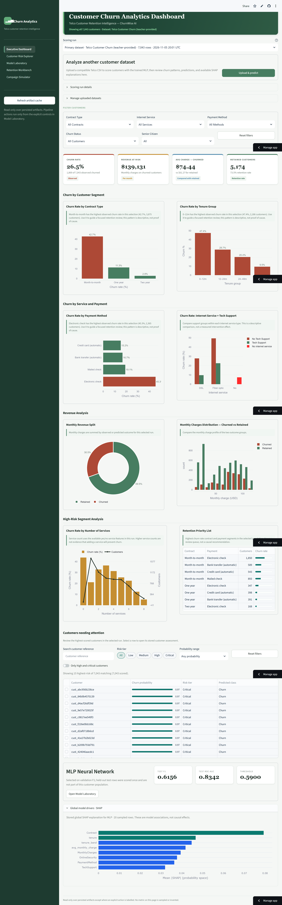

# ChurnWise AI

**A customer-churn prediction and retention analytics project built around the instructor-provided Telco Customer Churn dataset and a multilayer perceptron.**

[Open the live dashboard](https://gangninja-churnwise-ai-churnwisedashboardapp-lanwl3.streamlit.app/) · [Run locally](docs/HOW_TO_RUN.md) · [Project repository](https://github.com/GangNinja/ChurnWise-AI)



The dashboard above opens on the complete **7,043-customer** Telco population. It brings observed churn patterns, model scores, the customer attention list, MLP evaluation, and global SHAP drivers into one view.

## Project overview

ChurnWise AI follows customer data from validation through model training, evaluation, explanation, scoring, and retention analysis. Its default dashboard is backed by persisted artifacts from the teacher-provided dataset and the MLP trained for this project.

| | Current project setup |
| --- | --- |
| **Dataset** | IBM Telco Customer Churn, teacher-provided CSV; 7,043 rows and 21 source columns |
| **Target** | `Churn` — binary classification (`Yes` or `No`); kept out of model inputs |
| **Record identifier** | `customerID` identifies a customer and is not used as a predictor |
| **Model** | Multilayer Perceptron (MLP), 49 processed input features, 64- and 32-unit hidden layers, ReLU, dropout, and sigmoid output |
| **Training** | Binary cross-entropy loss, backpropagation, Adam optimizer, and early stopping |
| **Decision threshold** | 0.59, selected using validation data |
| **Held-out test results** | F1 **0.6156** · ROC-AUC **0.8342** · accuracy **0.7722** · precision **0.5575** · recall **0.6872** |

Metrics describe one held-out test split. They are evidence for this dataset and split, not a guarantee of performance on other customer populations.

## How the model works

```text
Telco customer fields
        ↓
Train-fitted preprocessing and feature encoding
        ↓
Input layer (49 features)
        ↓
Dense hidden layer (64, ReLU) → dropout
        ↓
Dense hidden layer (32, ReLU) → dropout
        ↓
Sigmoid output → churn probability
        ↓
Validation-selected threshold → retained / churn prediction
```

During training, binary cross-entropy measures prediction error. Backpropagation computes gradients through the network, and Adam updates model weights. A separate held-out test split evaluates the selected model; it is not used to tune the model or its threshold. The dashboard reports accuracy, precision, recall, F1, and ROC-AUC so performance is not reduced to one score.

## Executive Dashboard

The live dashboard starts on the full teacher-provided population and includes:

- **Observed churn overview:** churn rate, retained customers, and monthly charges associated with customers labeled as churned.
- **Customer segments:** contract, tenure, service, payment, revenue, and service-count views with descriptive insights.
- **Customer attention list:** sortable high-risk records with predicted probabilities, risk tiers, and predicted classes.
- **MLP evaluation:** held-out test F1 and ROC-AUC, plus the saved classification threshold.
- **SHAP drivers:** global feature attributions for the MLP. These describe model associations, not causes.
- **Upload & predict:** score a compatible Telco CSV with the trained MLP and review its results in the dashboard.
- **Uploaded-run management:** remove saved user-upload scoring runs; the primary dataset and bundled examples are protected.

The rest of the five-page app supports the same workflow:

1. **Executive Dashboard** — population-level insights, saved scores, upload and SHAP.
2. **Customer Risk Explorer** — inspect a customer assessment or score one customer.
3. **Model Laboratory** — review model performance, validation evidence, data quality, and provenance.
4. **Retention Workbench** — filter and prioritize customers for a budgeted outreach list.
5. **Campaign Simulator** — compare hypothetical retention scenarios using explicit assumptions.

## Try a dataset upload

On the Executive Dashboard, select **Upload & predict**, choose a CSV, review its detected columns, and score it. A compatible upload needs the feature columns used by the Telco MLP. The target column is optional for scoring and is not sent into the model.

Sample files are provided in [`testing_datasets/`](testing_datasets/README.md):

- Valid schema: `testing_datasets/proper_datasets/testing4.csv`
- Missing-column example: `testing_datasets/improper_datasets/testing4.csv`

After scoring, the uploaded run becomes available in the scoring-run selector. **Manage uploaded datasets** can remove saved user-upload runs. Streamlit Cloud uses an app-local filesystem, so uploaded-run artifacts may be cleared when the cloud app restarts or redeploys; the committed primary Telco dashboard snapshot remains the default.

## Run locally

From the repository root, create a Python 3.13 environment, install the locked dependencies, and start Streamlit:

```powershell
py -3.13 -m venv .venv
.\.venv\Scripts\Activate.ps1
python -m pip install -r requirements.lock.txt
python -m streamlit run churnwise/dashboard/app.py
```

Open the local URL printed by Streamlit. The repository includes the curated default dashboard artifacts, so you can inspect the primary scoring run without first retraining the model. For full environment setup, pipeline commands, configuration, and troubleshooting, see [docs/HOW_TO_RUN.md](docs/HOW_TO_RUN.md).

To start the full MLP pipeline from the supplied CSV, place the source file in your local data directory and follow the data and training workflow in the run guide. The raw teacher-provided CSV is not redistributed by this repository.

## Project workflow

```text
Validate data → split train / validation / test → fit preprocessing on train only
       → train MLP → select model and threshold on validation
       → evaluate held-out test once → explain with SHAP → score customers
       → explore risk and hypothetical retention scenarios
```

Artifacts retain dataset and model identifiers so that evaluation, explanations, scoring, and dashboard results can be traced to their source run. Dashboard pages read saved results; training and scoring are performed only through explicit actions.

## Repository layout

```text
churnwise/          Data workflow, MLP, explainability, scoring, and dashboard
data/               Dataset manifests and curated default data artifacts
artifacts/          Trained model, evaluation, SHAP, and scoring artifacts
testing_datasets/   Example CSVs with valid and invalid Telco schemas
docs/               Run guide, architecture, validation notes, and evidence
tests/              Unit, integration, and opt-in browser tests
```

## Important interpretation notes

- `Churn` is the observed outcome label. Predicted churn is a model estimate at the saved threshold; the two should not be conflated.
- SHAP values explain how the fitted model associated input features with its predictions. They do not establish causation.
- Segment charts are descriptive. They do not prove that a campaign or service change will prevent churn.
- Campaign Simulator results are hypothetical projections from user-supplied assumptions, not measured campaign results or causal uplift.
- Scores and thresholds are specific to this fitted model and dataset workflow. Validate a new dataset before using predictions for decisions.

## More documentation

- [How to run and troubleshoot](docs/HOW_TO_RUN.md)
- [Dashboard guide](docs/DASHBOARD.md)
- [Architecture](docs/ARCHITECTURE.md)
- [Validation summary and evidence boundaries](docs/VALIDATION_SUMMARY.md)
- [Project case study](docs/PROJECT_CASE_STUDY.md)
- [Synthetic upload datasets](testing_datasets/README.md)

## Deployment

The public app is deployed from the `main` branch using `churnwise/dashboard/app.py` on Streamlit Community Cloud:

[https://gangninja-churnwise-ai-churnwisedashboardapp-lanwl3.streamlit.app/](https://gangninja-churnwise-ai-churnwisedashboardapp-lanwl3.streamlit.app/)
