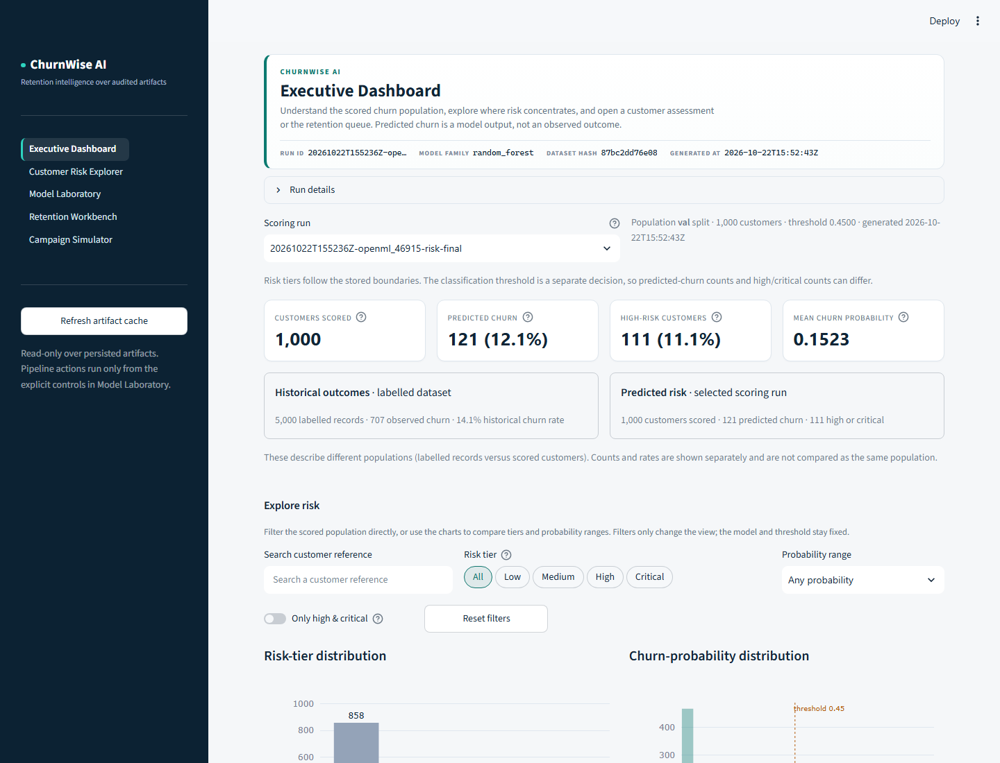
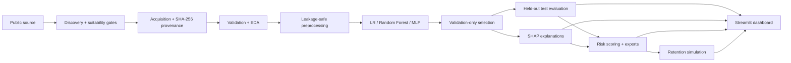

# ChurnWise AI

**Customer-churn intelligence from raw data to a defensible retention decision —
with leakage-safe modelling, traceable artifacts and honest evidence boundaries.**

ChurnWise AI is a local-first Python platform that discovers a public churn
dataset, verifies its provenance, validates it, builds a leakage-safe feature
pipeline, compares three model families, explains predictions with SHAP, scores a
customer population and simulates budget-constrained retention campaigns. A
Streamlit dashboard exposes the persisted results; every reported number is tied
to a saved artifact.

> **Status:** portfolio and research system, verified through Phase 13 and four
> post-Phase-13 validation workstreams. It is **not** production-deployed,
> causally validated or proven to generalise to other customer populations. See
> [VALIDATION_SUMMARY.md](docs/VALIDATION_SUMMARY.md) for the evidence boundary.



## The problem

A churn score is not an operational decision. Analysts still need to answer:

- Is the dataset suitable, and where did it come from?
- Was preprocessing fitted only on training data?
- Which model was selected, and on what validation criterion?
- Why does a particular customer receive a high risk score?
- Which customers fit a limited campaign budget, and what is a projection versus
  an observed outcome?

ChurnWise AI is designed for ML/data-engineering portfolio review and for
analysts exploring a reproducible public-data workflow. It makes those questions
explicit instead of hiding them behind a single accuracy number.

## At a glance

| Item | Verified result |
| --- | --- |
| Primary dataset | OpenML `46915`, 5,000 rows, 20 raw columns, 14.14% churn, MIT licence |
| Selected model | Random Forest, validation F1 0.7985, threshold 0.45 |
| Held-out test | F1 **0.8718**, ROC-AUC **0.9383**, PR-AUC **0.8973**, Brier **0.0390** |
| Pipeline | Seven stages: source → preprocess → train → evaluate → explain → score → simulate |
| Dashboard | 5 Streamlit pages over persisted artifacts |
| Default suite | **634 passed, 17 skipped** (post-audit rerun) |
| Browser E2E | **10 passed** across all 5 pages (opt-in) |
| Full-profile run | All seven stages in 328.259 s, 613.9 MiB peak |

The test split was scored once. Random Forest was selected on **validation F1**,
not test performance.

## What it does

1. **Discovery** — queries reviewed adapters for OpenML, UCI and a pinned IBM
   GitHub sample; applies nine suitability gates and ranks candidates
   deterministically.
2. **Acquisition** — downloads over allowlisted HTTPS, verifies size, format and
   SHA-256, stores content-addressed bytes and records provenance.
3. **Validation and EDA** — infers the target and positive class, runs 12 quality
   checks, produces a profile and plots, and records a pass/warn/block gate.
4. **Preprocessing** — makes a seeded stratified train/validation/test split,
   fits imputers, encoders, scalers and derived features on training rows only,
   and persists the pipeline, schema and fingerprints.
5. **Modelling and evaluation** — trains a Keras MLP and compares it with
   Logistic Regression and Random Forest; selects a family and threshold on
   validation, then evaluates test once.
6. **Explainability** — uses TreeSHAP, LinearSHAP and DeepSHAP, groups one-hot
   contributions back to source features, checks additivity and persists global
   and local explanations.
7. **Risk intelligence and simulation** — ranks customers by configurable risk
   tiers, validates batch CSVs, exports safely, and projects campaign outcomes
   under explicit budget, cost and effectiveness assumptions.

The single-command orchestrator records every stage, timing, warning and artifact
in `artifacts/pipelines/<run-id>/run.json`. Resume reuses only verified stages
whose configuration and artifacts still match.

## Verified evaluation

Reference benchmark `20261021T145336Z-openml_46915-bench-04595d7b`:

| Family | Validation F1 | Test F1 | Test ROC-AUC | Test PR-AUC | Test Brier |
| --- | ---: | ---: | ---: | ---: | ---: |
| Logistic Regression | 0.5905 | 0.6350 | 0.8741 | 0.5717 | 0.1460 |
| **Random Forest (selected)** | **0.7985** | **0.8718** | **0.9383** | **0.8973** | **0.0390** |
| MLP (Keras, `[64, 32]`) | 0.6937 | 0.7208 | 0.9266 | 0.7801 | 0.0944 |

These are held-out test results from one split. Five-fold CV F1 was RF 0.818
± 0.023, MLP 0.713 ± 0.038 and Logistic Regression 0.552 ± 0.025. The benchmark
metrics are committed in [docs/evidence/benchmark](docs/evidence/benchmark/);
the machine-readable table is in [metrics.json](docs/evidence/benchmark/metrics.json).

The **full-profile** run `post13-full-20261024c` later completed all seven stages
and reproduced these test metrics exactly. The **fast profile** used in Phase 13
live demonstrations is a laptop profile, not production hyperparameter evidence.

### Calibration is evaluated, not integrated

A separate validation-only experiment selected sigmoid calibration:
held-out Brier improved **0.0390 → 0.0306**, log loss **0.1684 → 0.1337** and ECE
**0.0686 → 0.0301**, while ROC-AUC and PR-AUC were unchanged. The calibrated
model serializes and reloads, but it is **not** wired into the production
registry, CLI, API or dashboard. The production candidate remains the
uncalibrated Random Forest at threshold 0.45.

### The second dataset is not transfer evidence

The pipeline was retrained on OpenML `42178` (IBM Telco, 7,043 rows, 26.54%
positive) after a documented ARFF-to-CSV format adapter. Logistic Regression was
selected on its own validation split and reached test ROC-AUC **0.8380**, PR-AUC
**0.6510** and F1 **0.6196**. These are new models on a different dataset; they
do not show that the primary model transfers to another population. The dataset's
`Public` licence field has no licence URL, so upstream reuse terms remain
unverified.

## Dashboard

The product has five pages, organised as one workflow — understand churn →
investigate a customer → evaluate the model → prioritise retention → simulate a
campaign:

1. **Executive Dashboard** — scored customers, predicted churn, interactive
risk-tier and probability distributions, verified original attributes and a
high-risk customer table with direct assessment navigation.
2. **Customer Risk Explorer** — a stored customer profile and assessment with
stored SHAP drivers, plus explicit individual and batch scoring. Upload a CSV,
preview its schema, score it with the fitted model, and open the saved scoring
run in Executive Dashboard for population-level insights.
3. **Model Laboratory** — held-out performance, CV stability, global SHAP, data
quality and provenance; discovery, acquisition and MLP training live only in a
collapsed Operations tab.
4. **Retention Workbench** — filter, rank, fit customers to a budget, select and
export a contact list.
5. **Campaign Simulator** — hypothetical scenario comparison from explicit
assumptions, with a financial value bridge and a chart of prevented churn across
scenarios attached to the selected scoring run.

The dashboard:

- reads persisted artifacts and never substitutes placeholder metrics;
- shows actionable empty states with the command needed to create evidence;
- caches by path, modification time and size;
- performs discovery, training, scoring and simulation only from explicit
  actions, never on ordinary page render;
- scores individual records and batch CSVs through the same risk service used by
  the CLI;
- includes six synthetic, schema-valid CSVs and six deliberately invalid CSVs
  under [`testing_datasets/`](testing_datasets/README.md) for upload demos;
- labels simulations as hypothetical and leaves unsupported financial fields
  undefined.

To try an upload, open **Customer Risk Explorer → Upload & predict dataset** and
choose **Proper · testing4.csv** from the bundled-dataset menu (1,800 rows), or
upload `testing_datasets/proper_datasets/testing4.csv`. Select **Score this
dataset**; the resulting scoring run becomes available in Executive Dashboard
and the other scoring-run selectors. To demonstrate schema validation, choose
**Improper · testing4.csv** or upload
`testing_datasets/improper_datasets/testing4.csv`; it is rejected because it is
missing `voice_mail_plan`. These generated examples are synthetic, and their
`CustomerChurned` column is ignored during prediction.

The upload examples require a fitted telecom-schema model (OpenML `46915`). The
offline `mini_churn.csv` fixture uses a different schema; the live workflow and
exact upload steps are documented in [docs/HOW_TO_RUN.md](docs/HOW_TO_RUN.md).

In Campaign Simulator, **Autofill example assumptions** creates varied draft
values; click **Run projection** to apply them. The value bridge and scenario
chart use the selected scoring run and applied assumptions. Amounts use the
scenario's configured value unit (the bundled examples use generic
`value_units`), and all outcomes are hypothetical rather than measured results.

The opt-in Playwright suite covers all five pages, risk filtering and CSV
download, stored customer detail, simulator projection, individual assessment,
batch upload and export, missing-model handling and empty-artifact states.

## Architecture



**Stack:** Python 3.13, NumPy, pandas, scikit-learn, TensorFlow/Keras, SHAP,
Streamlit, Plotly, Matplotlib, joblib, PyArrow, pytest and Playwright. Data and
artifacts are local files; there is no database, backend service or cloud
dependency.

The dataset, preprocessing pipeline, split fingerprint and model digest are
carried through evaluation, explanation, scoring and simulation. Artifacts from
different runs are rejected rather than silently combined.

## Quick start

Requires CPython 3.13. The verified environment is Windows 11. Run from the
repository root.

```powershell
py -3.13 -m venv .venv
.\.venv\Scripts\Activate.ps1
python -m pip install -r requirements.lock.txt

# Offline fixture: populates a real artifact tree in about 1 minute
python -m churnwise.cli run --dataset tests/fixtures/mini_churn.csv --fast --seed 13 --run-id getting-started

# Open the dashboard at http://localhost:8501
python -m streamlit run churnwise/dashboard/app.py
```

The fixture is a 160-row workflow test. Its metrics are **not** model
performance evidence. For the real dataset:

```powershell
# Network required; full profile, about 5.5 minutes and ~614 MiB peak
python -m churnwise.cli run --seed 42 --run-id reference-full
```

On macOS/Linux, use `python3.13 -m venv .venv` and `source .venv/bin/activate`;
that path is documented but not verified by this project. `requirements.lock.txt`
is Windows/CPython 3.13-specific; use `requirements.txt` on other platforms.

See **[docs/HOW_TO_RUN.md](docs/HOW_TO_RUN.md)** for prerequisites, configuration,
all workflows, outputs and troubleshooting.

## Tests

```bash
python -m pytest -q                         # 634 passed, 17 skipped
python -m pytest -q -m live --run-live      # 7 passed, network required

# Browser E2E, opt-in
CHURNWISE_BROWSER_E2E=1 python -m pytest tests/e2e -m browser -q   # 10 passed
```

On Windows PowerShell, set `$env:CHURNWISE_BROWSER_E2E="1"` first. The default 17
skips are the 7 live-network tests and 10 browser tests; both suites pass when
explicitly enabled. See [HOW_TO_RUN.md](docs/HOW_TO_RUN.md#i-run-the-tests) for
focused suites and browser setup.

## Data provenance

The primary reference dataset is OpenML `46915`: 5,000 rows, 20 raw columns,
`CustomerChurned` target, 14.14% positive and an MIT licence. SHA-256:
`87bc2dd76e08b5bffa37fdd97d3d418b41036fec3d4cbf7e31377542b8e85fb6`.
The 3,000 / 1,000 / 1,000 split has a recorded fingerprint. No datasets or model
binaries are committed; the fixture is synthetic and the live data is downloaded
on demand.

The repository deliberately keeps generated run artifacts and model binaries
out of Git. Small synthetic workflow fixtures and upload-demo CSVs are tracked;
curated machine-readable evidence is tracked under
[docs/evidence](docs/evidence/README.md), while full run trees are reproducible
and remain Git-ignored.

## Documentation

**Start here**

- [HOW_TO_RUN.md](docs/HOW_TO_RUN.md) — install, configure, run, test and troubleshoot
- [PROJECT_CASE_STUDY.md](docs/PROJECT_CASE_STUDY.md) — full technical narrative
- [VALIDATION_SUMMARY.md](docs/VALIDATION_SUMMARY.md) — curated post-Phase-13 evidence
- [DEMO_SCRIPT.md](docs/DEMO_SCRIPT.md) — 5–8 minute reviewer walkthrough
- [RESUME_BULLETS.md](docs/RESUME_BULLETS.md) — verified, ATS-friendly claims
- [PROJECT_SHOWCASE.md](docs/PROJECT_SHOWCASE.md) and [PROJECT_PRESENTATION.md](docs/PROJECT_PRESENTATION.md) — portfolio summaries

**Technical references**

- [ARCHITECTURE.md](docs/ARCHITECTURE.md) · [ROADMAP.md](docs/ROADMAP.md) · [ACCEPTANCE_CRITERIA.md](docs/ACCEPTANCE_CRITERIA.md)
- [DISCOVERY.md](docs/DISCOVERY.md) · [ACQUISITION.md](docs/ACQUISITION.md) · [VALIDATION.md](docs/VALIDATION.md) · [PREPROCESSING.md](docs/PREPROCESSING.md)
- [EVALUATION.md](docs/EVALUATION.md) · [EXPLAINABILITY.md](docs/EXPLAINABILITY.md) · [RISK_INTELLIGENCE.md](docs/RISK_INTELLIGENCE.md) · [SIMULATION.md](docs/SIMULATION.md)
- [DASHBOARD.md](docs/DASHBOARD.md) · [RUNBOOK.md](docs/RUNBOOK.md) · [DEPENDENCIES.md](docs/DEPENDENCIES.md) · [PERFORMANCE.md](docs/PERFORMANCE.md)
- [Evidence index](docs/evidence/README.md) · [Post-Phase-13 evidence](docs/evidence/post_phase13/README.md)
- Phase reports: [1](docs/PHASE1_REPORT.md) · [2](docs/PHASE2_REPORT.md) · [3](docs/PHASE3_REPORT.md) · [4](docs/PHASE4_REPORT.md) · [5](docs/PHASE5_REPORT.md) · [6](docs/PHASE6_REPORT.md) · [7](docs/PHASE7_REPORT.md) · [8](docs/PHASE8_REPORT.md) · [9](docs/PHASE9_REPORT.md) · [10](docs/PHASE10_REPORT.md) · [11](docs/PHASE11_REPORT.md) · [12](docs/PHASE12_REPORT.md)
- [Phase 13 final verification](docs/FINAL_VERIFICATION_REPORT.md) (historical) · [Phase 13 acceptance matrix](docs/FINAL_ACCEPTANCE_MATRIX.md) (historical) · [Integration defects](docs/INTEGRATION_DEFECTS.md)

## Repository layout

```text
churnwise/
  discovery/       source adapters, G1–G9 suitability gates, ranking
  acquisition/     allowlisted download, integrity, cache, provenance
  validation/      V1–V12 checks, target inference, gate, reports
  eda/             dataset profiles and plots
  preprocessing/   split, train-only fitting, persisted pipeline
  models/          Keras MLP, baselines, registry, inference
  evaluation/      metrics, thresholds, fold-safe CV, figures
  explain/         SHAP explainers, grouping, global/local artifacts
  intelligence/    risk service, tiers, ranking, drivers, exports
  simulation/      campaign assumptions, budget, projections
  dashboard/       Streamlit app, cached loaders, pages, actions
  pipeline/        orchestration, manifest, resume, cleanup
  cli.py           command-line entry points
docs/              guides, case study, validation, evidence, phase reports
tests/             unit, integration, opt-in live and browser tests
scripts/           documentation checker
```

## Limitations

- Metrics describe **one primary dataset and one held-out split**; there are no
  confidence intervals or repeated-holdout variance estimates.
- The Random Forest has a train/validation overfitting gap (train F1 ≈ 0.99).
- Calibration was evaluated but **not integrated** into the production candidate.
- The second-dataset experiment is robustness evidence, not external
  generalisation or model transfer.
- SHAP values are model attributions, not causal effects. Logistic Regression
  values are log-odds and are not comparable with tree/MLP values.
- Risk tiers are configurable business categories, not optimized or calibrated
  decision boundaries.
- Campaign projections are hypothetical: no causal model, no measured uplift and
  no observed retention outcome.
- MLP results are not bitwise reproducible while TensorFlow op determinism is
  disabled; splits, tree models, scoring and simulation are deterministic for
  fixed artifacts.
- The dashboard is local and single-user; training is synchronous. The browser
  suite covers one engine and one desktop viewport and does not test
  responsive/accessibility/visual regressions.
- The exact lock is Windows/CPython 3.13-specific and has no hash pins.

See [VALIDATION_SUMMARY.md](docs/VALIDATION_SUMMARY.md) and
[PROJECT_CASE_STUDY.md](docs/PROJECT_CASE_STUDY.md) for the complete discussion.

## Reproducing the evidence

The default test suite and fixture pipeline are safe to run locally. The full
live pipeline, second-dataset experiment and calibration experiment require
network access and generated artifacts; their commands and limitations are
documented in [VALIDATION_SUMMARY.md](docs/VALIDATION_SUMMARY.md#9-reproduction).

This repository describes a local system; it does not include a deployment. The
selected model, threshold and validation artifacts are unchanged.
