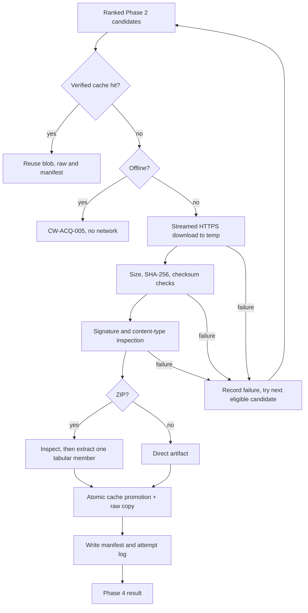

# ChurnWise AI — Autonomous Acquisition and Provenance (Phase 3)

Phase 3 turns a Phase 2 candidate into a verified local dataset. It does not
discover, clean, profile or model data. A successful download proves only that
the bytes are internally consistent and match their declared format; Phase 4
still decides whether the data is usable.

---

## 1. Inputs and outputs

**Inputs**

- A `SelectedCandidate` (the Phase 2 hand-off), a `DatasetCandidate`, a ranked
  sequence, or a `DiscoveryReport`.
- `reports/acquisition/candidates.json` from Phase 2, used by the `acquire`
  CLI. Only `eligible` ranking entries that are not duplicates are considered.
- Cache state and the configured licence policy.

**Outputs**

- `data/cache/sha256/<sha256>` — verified bytes.
- `data/raw/<source>/<dataset>/<version>/<filename>` — human-browsable copy.
- `data/extracted/<dataset>/<sha-prefix>/...` — extracted tabular file for ZIPs.
- `data/manifests/<dataset>.json` — provenance manifest.
- `reports/acquisition/attempts.json` — every candidate attempt and its result.
- An `AcquisitionResult` with the complete Phase 4 contract.

`acquire` runs Phase 2 discovery when no usable candidates report exists, so a
first-time run needs no URL, file or credential. It never downloads a dataset
that failed the Phase 2 gates.

---

## 2. Flow



---

## 3. Supported sources, methods and formats

| Source | Method | Formats observed |
| --- | --- | --- |
| OpenML | Direct `resource_url` from the documented API | ARFF (live selection) |
| UCI ML Repository | Direct `data_url` from the documented API | CSV |
| IBM pinned GitHub resource | Pinned `raw.githubusercontent.com` URL | CSV |

All downloads are ordinary HTTPS GETs. No source-specific session, signed URL
or credential flow is needed; if a future source requires one, it must be added
as a reviewed adapter rather than bolted onto the downloader.

| Format | Handling |
| --- | --- |
| `csv`, `tsv` | Text signature and delimiter check; stored as-is |
| `arff` | `@relation`/`@data` header check; stored as-is |
| `parquet` | `PAR1` header and trailer check; stored as-is (real Parquet fixture in tests) |
| `json` | JSON object/array prefix check; stored as-is |
| `xlsx` | Stored opaquely as a ZIP container; Phase 4 installs the parser |
| `zip` | Inspected and safely extracted; exactly one tabular member is required |

A ZIP with zero or multiple tabular members is rejected rather than guessed.
Non-tabular safe members (for example a README) are recorded and ignored.

---

## 4. Storage layout

```text
data/
├── cache/sha256/<sha256>                    # verified, content-addressed
├── raw/<source>/<dataset>/<version>/<file>  # human-browsable copy
├── extracted/<dataset>/<sha-prefix>/...     # extracted tabular file
├── manifests/<dataset>.json                 # provenance record
├── manifests/quarantine/*.json              # stale/invalid manifests
├── cache/quarantine/*.invalid               # replaced bad blobs
└── tmp/<run-id>/...                         # confined temporary work

reports/acquisition/attempts.json            # every attempt and final result
```

`raw` is a **copy**, not a hardlink. The raw tree is intended for humans to
inspect or edit; a hardlink would let an edit silently corrupt the verified
cache blob. The cache is the authoritative artifact.

All managed paths are derived from sanitized components. The subsystem never
deletes a path outside `data/`.

---

## 5. Download safety

- HTTPS only; host allowlist from the Phase 2 source registry; port 443; no
  embedded credentials.
- Redirects are followed manually (maximum 3) and every hop is re-validated.
- Streamed writes with a 64 KiB chunk size; the whole artifact is never held in
  memory.
- `max_download_bytes` (default 200 MB) is enforced from `Content-Length` and
  again while writing.
- `expected_size`, when the source reports one, must match exactly.
- Bounded retries for timeouts, connection failures, 429 and 5xx; `Retry-After`
  is honoured up to 10 s. 4xx responses are not retried.
- 401/403 are permission failures (`CW-ACQ-006`), not silent fallbacks that
  bypass access control.
- A failed, interrupted or oversized transfer removes its temporary part file.
  Only a verified file is promoted into the cache.
- The `User-Agent` identifies ChurnWise; no credentials, cookies or tokens are
  sent or stored.

---

## 6. Content validation

A filename and `Content-Type` are hints, never proof. The downloaded bytes are
checked before promotion:

- HTML (`text/html`, `application/xhtml+xml`, or an HTML signature) is rejected
  with `CW-ACQ-003`, even on HTTP 200.
- Executable/script magic (`MZ`, ELF, Mach-O, shebang) is rejected.
- Empty files and content that does not match the declared format are rejected.
- Parquet requires `PAR1` at both ends.
- CSV/TSV require multiple text lines and a plausible delimiter.
- ARFF requires an `@relation` or `@data` header.
- A mismatch between the declared candidate format and the actual signature is
  rejected rather than relabelled.

The content type is recorded when present; a missing header does not fail an
artifact whose signature is correct.

---

## 7. Archive safety

`zipfile` inspection happens before extraction:

- absolute paths, `..`, backslashes and drive-letter paths are rejected;
- control characters, colon components, Windows-reserved device names and
  trailing dots/spaces are rejected;
- ordinary spaces and non-ASCII characters are accepted (for example
  `churn données 2024.csv`), because they are safe managed-tree filenames;
- symlink entries are rejected;
- encrypted members are rejected;
- executable/script members are rejected;
- member count and total uncompressed size are capped;
- only the single supported tabular member is extracted;
- extraction writes inside a fresh temporary directory under `data/tmp`, then
  the whole directory is atomically promoted;
- corrupted archives and CRC failures are `CW-ACQ-009`; unsafe content is
  `CW-ACQ-010`.

Downloaded content is never executed, imported or evaluated.

---

## 8. Integrity and provenance

SHA-256 is computed locally while streaming and recomputed on cache reuse. A
publisher checksum is compared only when the source actually supplied one; its
status is one of `verified`, `mismatch` or `unavailable`. OpenML publishes an MD5
in its dataset description, and Phase 2 now carries it into candidate evidence,
so the live OpenML artifact is checked against both its publisher MD5 and the
locally recomputed SHA-256. UCI and GitHub do not expose a dataset checksum in
their metadata. A local hash is not presented as publisher authentication.

### 8.1 Manifest schema

```json
{
  "schema_version": "1.0",
  "run_id": "20261020T172001Z-1a2b3c4d",
  "dataset_id": "openml:46915",
  "dataset_sha256": "87bc2dd76e08b5bffa37fdd97d3d418b41036fec3d4cbf7e31377542b8e85fb6",
  "seed": 42,
  "code_version": "0.3.0",
  "title": "churn",
  "source": {
    "provider": "OpenML",
    "source_id": "openml",
    "dataset_id": "46915",
    "landing_url": "https://www.openml.org/d/46915",
    "download_url": "https://www.openml.org/data/v1/download/22125226",
    "license": {"name": "MIT License", "url": null, "status": "verified"},
    "publisher": "See original data source.",
    "reported_version": "4"
  },
  "retrieved_at": "2026-10-20T17:20:01Z",
  "file": {
    "filename": "22125226.arff",
    "bytes": 475249,
    "sha256": "87bc2dd76e08b5bffa37fdd97d3d418b41036fec3d4cbf7e31377542b8e85fb6",
    "content_type": null,
    "format": "arff",
    "cache_path": "cache/sha256/87bc2dd76e08b5bffa37fdd97d3d418b41036fec3d4cbf7e31377542b8e85fb6",
    "raw_path": "raw/openml/46915/2025-04-30/22125226.arff",
    "extracted_path": null,
    "extracted_sha256": null,
    "extracted_files": []
  },
  "integrity": {
    "verified": true,
    "method": "sha256_recomputed",
    "expected_size": null,
    "publisher_checksum": {
      "algorithm": "md5",
      "value": "86dd09210baaa4dfaa502a23703a9436"
    },
    "checksum_status": "verified",
    "archive_members": []
  },
  "acquisition": {
    "method": "https_download",
    "attempt": 1,
    "status": "success",
    "fallback_of": null,
    "candidate_rank": 1,
    "duration_ms": 3286,
    "warnings": [
      "source did not report an expected size; actual bytes recorded"
    ]
  },
  "discovery": {
    "candidate": {"...": "sanitized Phase 2 snapshot"},
    "candidate_fingerprint": "…",
    "rank": 1,
    "score": 0.970667,
    "origin": "phase2_ranking",
    "selection": "highest-ranked eligible Phase 2 candidate",
    "limitations": []
  },
  "notes": []
}
```

Unknown values remain `null`: no licence URL, size, checksum or extracted hash
is invented. Sensitive URL query parameters (`token`, `key`, `signature`,
`X-Amz-*`, `session`, etc.), fragments and embedded credentials are removed from
every stored URL and from the candidate snapshot. Non-sensitive parameters are
kept so the source remains identifiable.

`acquisition.attempt` is the 1-based ordinal of the attempt within the run that
produced the artifact; `acquisition.candidate_rank` is the independent Phase 2
rank. On a fallback they can differ, so both are recorded.

`run_id`, `dataset_sha256`, `seed` and `code_version` make the manifest
self-identifying; `extracted_sha256` is present whenever an archive member was
extracted and is rechecked on every cache hit. `integrity.verified` must be a
JSON boolean: a string such as `"false"` is rejected rather than coerced to a
truthy value.

Manifest writes validate the schema first and use a temporary file plus
`os.replace`; a partial manifest is never visible as valid.

---

## 9. Cache behavior

A cache hit requires all of the following:

- the manifest schema validates;
- the dataset id and the stable candidate fingerprint match;
- the cache blob exists, has the recorded byte size and recomputes to the
  recorded SHA-256;
- the raw copy exists and matches, or can be restored from the verified blob;
- an extracted member exists and matches its recorded SHA-256, or can be
  re-extracted from the verified blob.

The fingerprint covers ids, sanitized resource URL, format, size/row/feature
counts, target, licence/access posture, source version and published checksum,
but **not** `retrieved_at`; discovery runs on different days reuse the same
verified bytes, while a changed checksum or access policy forces a new
acquisition.

An extracted archive member is accepted only when its recorded SHA-256 matches;
a missing or tampered extracted file is re-extracted from the verified cache
blob. The re-extracted bytes are hashed again against `extracted_sha256`; a
persistent mismatch is `CW-ACQ-013`, so a corrupt provenance record cannot
silently hand a different file to Phase 4. If a manifest or blob is
stale/corrupt, it is moved to a quarantine directory and the candidate is
re-acquired. A valid cached artifact is never overwritten by an unverified
download. A failure to restore the human-browsable raw copy is reported as a
structured storage warning/failure rather than escaping the coordinator.

Explicit invalidation:

```python
from churnwise.acquisition import DatasetStore
store = DatasetStore(data_dir)
store.invalidate("openml:46915")
```

This removes the manifest, raw copy and extracted files for that dataset and
retains the content-addressed blob (other manifests may share it). The result
lists the removed paths.

---

## 10. Fallback policy

Candidates are tried in Phase 2 rank order. A failure is recorded with its
category and retryability, then the next eligible candidate is attempted.
Transient network failures are retried inside the downloader within the
configured limit; integrity, format, archive, permission and storage failures
are not retried.

When a later candidate succeeds, `acquisition.fallback_of` records the previous
candidate id and `attempts.json` keeps every prior failure. If every candidate
fails, the result is a structured failure with code `CW-ACQ-012` (or the single
shared failure code, such as `CW-ACQ-005` for an offline cold cache) and all
causes. No unrelated dataset is substituted.

---

## 11. Error codes

| Code | Meaning | Category | Retryable |
| --- | --- | --- | --- |
| `CW-ACQ-001` | No eligible candidate / no direct resource | candidate | no |
| `CW-ACQ-002` | Size or publisher-checksum mismatch | integrity | no |
| `CW-ACQ-003` | Unexpected content, HTML or format mismatch | format | no |
| `CW-ACQ-004` | HTTP/network failure | network | transient cases only |
| `CW-ACQ-005` | Offline and no verified cache | offline | no |
| `CW-ACQ-006` | Access, licence or allowlist refusal | permission | no |
| `CW-ACQ-007` | Download/extraction size limit | storage/archive | no |
| `CW-ACQ-008` | Local storage or disk failure | storage | no |
| `CW-ACQ-009` | Corrupt or truncated archive | archive | no |
| `CW-ACQ-010` | Unsafe/ambiguous archive | archive | no |
| `CW-ACQ-011` | Interrupted transfer | interrupted | downloader retries |
| `CW-ACQ-012` | Every candidate failed | candidate | no |
| `CW-ACQ-013` | Reserved for cache invalidation failure | cache | no |

Every failure carries a remediation string in the result and attempt log.

---

## 12. Phase 4 result contract

`AcquisitionResult.to_dict()`:

| Field | Meaning |
| --- | --- |
| `schema_version`, `phase` | `1.0`, `3` |
| `run_id`, `generated_at` | unique acquisition run identity |
| `dataset_sha256`, `seed`, `code_version` | artifact identity and reproducibility metadata |
| `status` | `success` or `failure` |
| `cached` | true when no network was used |
| `candidate` | sanitized discovery candidate snapshot |
| `artifact` | dataset id, filename, format, bytes, sha256, content type, cache/raw/extracted relative paths |
| `manifest` | full provenance manifest |
| `manifest_path` | absolute manifest path for the current machine |
| `storage.data_dir` | managed data root |
| `attempts` | every attempt with status, error code, category, duration |
| `warnings` | non-fatal caveats (unknown checksum/size, archive policy, offline) |
| `failure` | code, message, category, retryable, remediation, causes |

Phase 4 must check `status == "success"`, `manifest.integrity.verified is true`
and the artifact hash again before consuming the file. A successful download is
not a suitability claim.

---

## 13. CLI and configuration

```bash
# discover, then acquire
python -m churnwise.cli discover
python -m churnwise.cli acquire

# acquire without network (requires a warm cache)
python -m churnwise.cli acquire --offline

# force fresh discovery, then acquire
python -m churnwise.cli acquire --refresh-discovery --allow-unverified-license

# machine-readable result
python -m churnwise.cli acquire --json
```

`acquire` reads `reports/acquisition/candidates.json`; if it is absent or has no
eligible candidate, it runs Phase 2 discovery first. `CHURNWISE_OFFLINE=1`
forces cache-only mode exactly like `--offline`. Exit codes: `0` success, `2`
structured acquisition failure, `3` invalid configuration/report write failure.

Environment variables (in addition to the Phase 2 variables):

| Variable | Default | Meaning |
| --- | --- | --- |
| `CHURNWISE_DOWNLOAD_TIMEOUT_S` | 60 | Per-request download timeout |
| `CHURNWISE_MAX_DOWNLOAD_BYTES` | 209715200 (200 MB) | Artifact cap |
| `CHURNWISE_MAX_EXTRACTED_BYTES` | 314572800 (300 MB) | Archive expansion cap |
| `CHURNWISE_MAX_ARCHIVE_MEMBERS` | 200 | Maximum ZIP members |
| `CHURNWISE_DATA_DIR` | `./data` | Managed dataset root |

CLI overrides exist for the size/timeout values and `--data-dir`.

---

## 14. Testing

```bash
# deterministic mocked suite; no network
.venv/Scripts/python -m pytest -q

# opt-in real-source tests
.venv/Scripts/python -m pytest -q --run-live
```

Mocked tests cover direct downloads, redirects, retries, timeouts, interrupted
and incomplete transfers, size caps, expected sizes, publisher checksums, HTML
disguised as CSV, CSV/TSV/ARFF/Parquet signatures, corrupt and unsafe archives,
path traversal, symlinks, control-character names, executable members, atomic
promotion, cache reuse, stale/corrupt cache recovery, extracted-member
tampering, policy changes on cache hits, rank-order loading, malformed report
handling, fallback lineage, total failure, sensitive URL sanitization, the
offline environment variable and the Phase 4 result contract. The live test
performs real discovery and acquisition and then offline reuse.

Actual results are recorded in [PHASE3_REPORT.md](PHASE3_REPORT.md).

---

## 15. Known limitations

- **Checksum availability varies.** OpenML supplies an MD5, which is verified;
  UCI and GitHub do not expose a dataset checksum, so their manifests would
  record `checksum_status: "unavailable"` and a local SHA-256 only. OpenML still
  reports no expected byte size.
- **One tabular member per ZIP.** Multi-file archives are rejected rather than
  guessed at.
- **No resumable downloads.** An interrupted transfer restarts from zero within
  the retry limit; there is no HTTP `Range` continuation.
- **Bounded content probes, not schema validation.** Acquisition checks format
  signatures and basic structure only; Phase 4 owns full parsing, schema and
  quality judgement.
- **xlsx is stored, not parsed.** Its parser belongs to Phase 4.
- **Cache blobs are not garbage-collected.** Invalidation removes pointers and
  extracted copies but retains content-addressed bytes for safety.
- **Fallback does not rediscover.** It only uses eligible candidates already in
  the Phase 2 report.
- **No parallel downloads.** Sequential acquisition keeps rate-limit behaviour
  predictable.
- **Network latency dominates.** The live 475 KB OpenML artifact took 2–6
  seconds end-to-end across observed runs; this is a measurement, not a
  guarantee.
