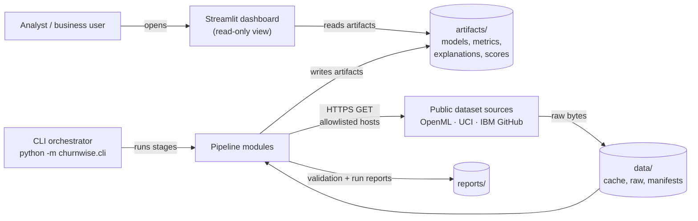
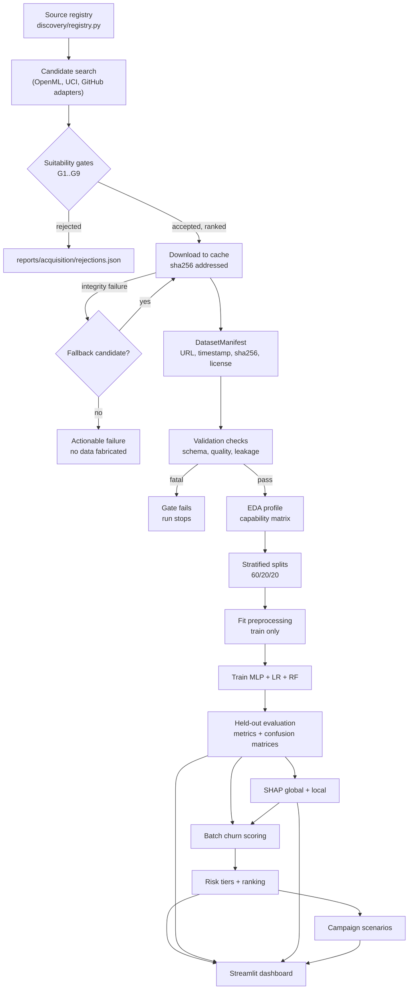
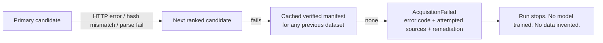

# ChurnWise AI — System Architecture

| Field | Value |
| --- | --- |
| Document status | Phase 1 baseline (approved for implementation pending review) |
| Version | 1.0 |
| Date | 2026-10-20 |
| Scope | Architecture and design constraints only. No application code is implemented in Phase 1. |
| Related | [README.md](../README.md) · [ROADMAP.md](ROADMAP.md) · [ACCEPTANCE_CRITERIA.md](ACCEPTANCE_CRITERIA.md) · [PHASE1_REPORT.md](PHASE1_REPORT.md) |

---

## 1. Purpose and scope

ChurnWise AI is an **autonomous-data customer retention intelligence platform**. It discovers its own training data from public sources, verifies and caches it with provenance, validates schema and quality, prepares leakage-safe features, trains a TensorFlow/Keras MLP alongside Logistic Regression and Random Forest baselines, benchmarks them on a held-out test set, explains every prediction with SHAP, ranks customers by churn risk, simulates retention campaigns under explicit assumptions, and presents everything in a Streamlit dashboard.

This document defines:

- the module boundaries and dependency rules,
- the data, model and artifact contracts that connect those modules,
- the requirements for autonomous dataset discovery and acquisition,
- the ML, evaluation and explainability design,
- the risk-intelligence and campaign-simulation semantics,
- the dashboard architecture and its failure modes,
- the cross-cutting rules (reproducibility, security, performance, non-goals).

It deliberately contains **no performance claims**. All metrics in later phases must be measured on real held-out data.

---

## 2. System context



### 2.1 Design principles

| # | Principle | Architectural consequence |
| --- | --- | --- |
| P1 | **Autonomous by default** | First-run setup takes no dataset argument. Discovery + acquisition are pipeline stages, not user chores. |
| P2 | **Honest by construction** | No synthetic data, no fabricated metrics, no silent substitution. Every number is traceable to a run ID, artifact and dataset hash. |
| P3 | **File-artifact architecture** | Modules communicate through versioned files on disk, not a database or a service. Simplest thing that preserves reproducibility. |
| P4 | **Leakage-safe** | Splits are created before any fitting; all preprocessing is fitted on training data only; the test set is touched once. |
| P5 | **Single process, single machine** | Batch pipeline + Streamlit UI. No backend service, auth, queue, container or cloud dependency. |
| P6 | **Gate before spend** | Cheap suitability checks run before downloads; validation gates run before training; a failed gate stops the run with an actionable message. |
| P7 | **Capability-driven features** | Source datasets differ; feature engineering adapts to declared capabilities instead of assuming one fixed schema. |
| P8 | **Explain the model you shipped** | SHAP explanations are produced for the same model, preprocessing and dataset hash used for scoring. |

---

## 3. Environment baseline (audited)

Full evidence is in [PHASE1_REPORT.md](PHASE1_REPORT.md#2-environment-findings). Constraints that shape the design:

| Constraint | Observation (2026-10-20) | Design impact |
| --- | --- | --- |
| OS / Python | Windows 11, Python 3.13.0 (system interpreter, no venv) | CPU-only TensorFlow; `n_jobs` bounded; POSIX-specific tooling avoided |
| TensorFlow | Not installed; `tensorflow` 2.20.0 / 2.21.0 wheels available for cp313 | MLP is feasible; install is a Phase 2 prerequisite, in an isolated venv |
| Keras | Standalone Keras 3 installed but **unimportable** (no TF backend) | Must not rely on global site-packages; venv required |
| SHAP | Not installed; `shap` 0.54.1 available | Explainability feasible; watch explainer runtime on CPU |
| Present | numpy 2.1.2, pandas 2.2.3, scikit-learn 1.5.2, streamlit 1.56.0, matplotlib, seaborn, plotly, joblib, requests, pytest, scipy, pyarrow, openpyxl | Baseline stack exists; versions must be pinned to avoid drift |
| Git | Working directory is **not** a Git repository | Code version is recorded as `unversioned` until the repository is initialized |
| Disk | 158 GB free | Content-addressed cache and multi-run artifacts are affordable |

**Decision:** all subsequent phases run inside a project-local virtual environment (`.venv`) built from a pinned `requirements.txt`. Global site-packages are never modified.

---

## 4. Module map

```text
churnwise/
├── __init__.py
├── config.py                  # typed settings, paths, seeds, env overrides
├── contracts.py               # dataclasses + schema versions for every artifact
├── pipeline.py                # stage graph, resume, run manifest
├── cli.py                     # argparse entry points (acquire|validate|prepare|train|evaluate|explain|score|simulate|run)
├── discovery/
│   ├── registry.py            # static source registry (OpenML, UCI, IBM GitHub mirror)
│   ├── adapters/openml.py     # search + metadata via OpenML REST API
│   ├── adapters/uci.py        # search + metadata via UCI REST API
│   ├── adapters/github.py     # pinned raw-file resources (allowlisted repo paths)
│   └── suitability.py         # eligibility gates G1..G9, scoring, ranking, rejection log
├── acquisition/
│   ├── downloader.py          # HTTPS-only, allowlist, redirect re-check, size cap, retries
│   ├── integrity.py           # sha256, archive safety, content sniffing, parser probe
│   ├── store.py               # content-addressed blob store + pointer manifests
│   └── provenance.py          # DatasetManifest read/write, attempt log
├── validation/
│   ├── loader.py              # safe CSV/TSV/ARFF/Parquet/JSON/XLSX parsing
│   ├── targets.py             # target detection + 1 = churned normalisation
│   ├── checks.py              # V1..V12 with severity, issues and evidence
│   ├── gate.py                # severity rollup -> pass / pass_with_warnings / reject
│   ├── report.py              # JSON + Markdown validation reports
│   └── coordinator.py         # verify -> load -> profile -> gate, candidate fallback
├── eda/
│   ├── profile.py             # column profiling, target balance, capability detection
│   └── plots.py               # distributions, correlation, target-conditional plots
├── preprocessing/
│   ├── schema.py              # column role mapping (id/target/numeric/categorical)
│   ├── split.py               # stratified train/val/test splits + split fingerprint
│   ├── features.py            # derived features guarded by capabilities
│   ├── pipeline.py            # ColumnTransformer assembly (impute/scale/encode)
│   └── artifacts.py           # persist/load fitted preprocessors with schema metadata
├── models/
│   ├── mlp.py                 # functional Keras MLP builder (ReLU/sigmoid/dropout/L2)
│   ├── baselines.py           # LogisticRegression and RandomForest estimators (Phase 7)
│   ├── trainer.py             # fit loop, callbacks, class weights, history capture
│   ├── inference.py           # matrix/raw-record probability inference + thresholds
│   ├── registry.py            # model files + metadata, keyed by run_id, digest-verified
│   └── reporting.py           # diagnostics, learning curves, JSON/Markdown reports
├── evaluation/
│   ├── metrics.py             # accuracy, precision, recall, F1, ROC-AUC, PR-AUC, Brier, curves
│   ├── thresholds.py          # validation-only operating-threshold selection and sweeps
│   ├── cv.py                  # optional stratified CV on train+validation rows
│   ├── benchmark.py           # shared-data benchmark, selection, artifacts, regeneration
│   ├── plots.py               # confusion/ROC/PR/comparison/threshold figures
│   └── reporting.py           # benchmark Markdown and console summary
├── explain/
│   ├── explainers.py          # per-family SHAP explainer selection
│   ├── grouping.py            # one-hot -> source-column attribution rollup
│   └── service.py             # global + local explanation generation and caching
├── intelligence/
│   ├── scoring.py             # batch + single-customer inference, one code path
│   ├── ranking.py             # risk tiers, ranking, filters, value-at-risk ordering
│   └── segments.py            # reusable customer segments for targeting
├── simulation/
│   ├── campaign.py            # scenario engine (targeting, cost, saves, ROI, break-even)
│   └── assumptions.py         # explicit defaults, validation, sensitivity grids
├── dashboard/
│   ├── app.py                 # Streamlit entry (navigation + artifact availability checks)
│   ├── data_access.py         # cached, read-only artifact loaders
│   ├── pages/                 # 7 pages (see §10)
│   └── components/            # tables, charts, badges, assumption panels
└── logging_utils.py           # structured JSONL logging, no PII
```

### 4.1 Dependency rules

Enforced by a Phase 12 import-linter style test:

1. `contracts.py` and `config.py` depend on nothing internal.
2. Stages depend **forward only**: `discovery → acquisition → validation → eda → preprocessing → models → evaluation → explain → intelligence → simulation`.
3. `dashboard/` may import `contracts`, `config` and `intelligence.segments` **only**; it must never import training, acquisition or explainer code.
4. `evaluation/` must not mutate models, preprocessors or data.
5. `cli.py`/`pipeline.py` orchestrate; they contain no business logic.
6. No module writes outside its declared artifact directory (§9).

### 4.2 Why these boundaries

- **Discovery separate from acquisition:** lets us score and reject candidates without touching the network payload, and keeps the "should we download this?" policy auditable.
- **Acquisition separate from validation:** integrity (hash, archive safety, parser probe) is a security concern; schema/quality is a modelling concern. Different failure semantics.
- **Preprocessing separate from models:** guarantees the identical transformed matrix is used by MLP, LR and RF — the core fairness condition for the benchmark.
- **Explain separate from evaluation:** SHAP is expensive and model-specific; it consumes a trained model + preprocessor + reference data, and produces its own artifacts.
- **Intelligence separate from explain:** scoring must work even if explanations are unavailable; explanations enrich, they do not gate ranking.
- **Simulation separate from intelligence:** projections are assumption-driven arithmetic, must never be mixed with measured model output.

---

## 5. End-to-end data and artifact flow



### 5.1 Stage contract table

| Stage | Inputs | Outputs (artifacts) | Blocking gate |
| --- | --- | --- | --- |
| Discover | registry, criteria (min rows, target hints) | `reports/acquisition/candidates.json` | ≥1 candidate passes G1–G9 |
| Acquire | ranked candidate, cache | `data/cache/sha256/<hash>`, `data/raw/<provider>/<slug>/<version>/<file>`, `data/manifests/<dataset_id>.json`, `reports/acquisition/attempts.json` | integrity + parser probe pass |
| Validate | manifest + raw file | `reports/validation/<dataset_id>.{json,md}`, `data/manifests/<dataset_id>.profile.json`, `reports/validation/attempts.json` | no fatal check; target + feature roles resolvable |
| EDA | validated frame | `reports/eda/<dataset_id>.json`, `reports/eda/*.png` | capability matrix resolves ≥3 numeric or ≥1 categorical feature |
| Prepare | validated frame, profile, config seed | `artifacts/splits/<run_id>.json`, `artifacts/preprocessors/<run_id>/{pipeline.joblib,schema.json}`, `artifacts/prepared/<run_id>/{matrices.npz,summary.json}`, `reports/preprocessing/<run_id>.{json,md}` | split fingerprint reproducible; no target leakage; fitted state from train only |
| Train | preprocessor, splits, config | `artifacts/models/<run_id>/<family>/{model.keras,best.keras,history.json,learning_curves.png,metadata.json}`, `reports/models/<run_id>.{json,md}` | preprocessor hash + split fingerprint match Phase 5; no test metric used for selection |
| Evaluate | models, held-out split | `artifacts/evaluation/<run_id>/{metrics.json,benchmark.md,*.png}` | all three families evaluated on identical test rows |
| Explain | model, preprocessor, reference sample | `artifacts/explanations/<run_id>/{global.json,summary.png,local/*.json}` | additive-consistency tolerance met |
| Score | model, preprocessor, scoring frame | `artifacts/predictions/<run_id>/churn_scores.parquet` | score count == input row count |
| Rank | scores, threshold config | `artifacts/predictions/<run_id>/{risk_summary.json,tiers.csv}` | tiers reconcile to 100% of scored rows |
| Simulate | ranked scores, scenario params | `artifacts/simulations/<scenario_id>.json`, `.md` | assumptions complete and labeled |
| Present | all artifacts | rendered Streamlit pages | artifacts load; no fabricated placeholders |

**Run identity.** `run_id = <UTC timestamp>Z-<dataset_id>-<config_hash8>`. Every artifact records `run_id`, `dataset_sha256`, `preprocessor_hash`, `seed`, `code_version`. A dashboard page may only combine artifacts sharing `run_id` (or an explicit compatible-derived relationship recorded in `run_manifest.json`).

---

## 6. Contracts

All contracts are Python dataclasses in `contracts.py` with `to_json()/from_json()`, a `schema_version` field, and a JSON Schema export used by contract tests. Cross-stage handoff is **only** through these structures.

### 6.1 Canonical dataset roles

Source datasets do not share column names, so the platform maps each dataset to **roles**, not fixed names.

| Role | Cardinality | Required | Notes |
| --- | --- | --- | --- |
| `target` | 1 | yes | Binary churn label; normalized to `1 = churned` |
| `id` | 0..1 | no | Pseudonymous customer key; excluded from training, retained for output |
| `numeric` | ≥1 | yes | Continuous or ordinal predictors |
| `categorical` | ≥0 | no | Low-cardinality nominal predictors |
| `revenue_proxy` | 0..1 | no | Monthly charge / value column used by simulation when present |

```json
{
  "schema_version": "1.0",
  "dataset_id": "openml-45076",
  "target": {"column": "class", "positive_values": ["1", "yes", "true"], "rate": 0.0},
  "id": {"column": null},
  "numeric": ["tenure", "monthly_charge"],
  "categorical": ["contract_type", "payment_method"],
  "revenue_proxy": {"column": "monthly_charge"},
  "dropped": [{"column": "state", "reason": "id-like high cardinality"}],
  "capabilities": {"has_tenure": true, "has_monthly_charge": true, "has_contract": true}
}
```

### 6.2 DatasetManifest (provenance record)

```json
{
  "schema_version": "1.0",
  "dataset_id": "ibm-telco-churn",
  "source": {
    "provider": "github",
    "landing_url": "https://github.com/IBM/telco-customer-churn-on-icp4d",
    "download_url": "https://raw.githubusercontent.com/.../Telco-Customer-Churn.csv",
    "license": "unverified",
    "license_url": null,
    "reported_version": "master@2026-10-20"
  },
  "retrieved_at": "2026-10-20T00:00:00Z",
  "file": {"filename": "Telco-Customer-Churn.csv", "bytes": 970457,
           "sha256": "...", "content_type": "text/plain", "encoding": "utf-8"},
  "integrity": {"verified": true, "method": "sha256_recomputed",
                "source_checksum": null, "archive_members": []},
  "acquisition": {"attempt": 1, "fallback_of": null, "duration_ms": 0},
  "notes": []
}
```

Rules: `retrieved_at` is UTC and never back-dated; `sha256` is computed locally from stored bytes; a manifest with `integrity.verified = false` may not be consumed by later stages; `license` values are `verified:<id>`, `unverified`, or `restricted`.

### 6.3 ValidationReport

```json
{
  "schema_version": "1.0",
  "dataset_id": "ibm-telco-churn",
  "manifest_sha256": "...",
  "generated_at": "2026-10-20T00:00:00Z",
  "checks": [
    {"id": "V3", "name": "target_binary", "severity": "fatal", "passed": true,
     "detail": "2 classes, positive rate 0.265", "evidence": {"classes": ["No", "Yes"]}}
  ],
  "summary": {"n_rows": 7043, "n_cols": 21, "missing_cell_pct": 0.0,
              "duplicate_rows": 0, "target_rate": 0.2654,
              "constant_columns": [], "id_like_columns": ["customerID"],
              "leakage_risks": ["customerID is a unique key; exclude from training"]},
  "gate": {"passed": true, "blocking": []}
}
```

### 6.4 SplitSpec

```json
{
  "schema_version": "1.0", "run_id": "...", "dataset_sha256": "...",
  "strategy": "stratified", "seed": 42,
  "sizes": {"train": 0, "val": 0, "test": 0},
  "fingerprint": "sha256(sorted(train_idx)+sorted(val_idx)+sorted(test_idx))",
  "constraints": {"test_touched": false, "fitted_on": "train_only"}
}
```

The fingerprint lets any later stage prove it is using the same split — and lets tests assert determinism.

### 6.5 ModelArtifact metadata

```json
{
  "schema_version": "1.0", "run_id": "...", "family": "mlp",
  "framework": "tensorflow.keras", "path": "model.keras",
  "seed": 42, "dataset_sha256": "...", "preprocessor_hash": "...",
  "hyperparameters": {"hidden": [64, 32], "dropout": [0.3, 0.2], "l2": 0.0001,
                      "optimizer": "adam", "lr": 0.001, "batch_size": 64,
                      "max_epochs": 150, "early_stopping_patience": 12},
  "training": {"epochs_run": 0, "best_epoch": 0, "best_val_loss": 0.0,
               "class_weight": {}, "history": "history.json"},
  "trained_at": "2026-10-20T00:00:00Z", "code_version": "unversioned"
}
```

### 6.6 EvaluationResult

```json
{
  "schema_version": "1.0", "run_id": "...", "family": "rf",
  "threshold": 0.5, "n_test": 0, "positive_rate": 0.0,
  "confusion_matrix": {"tn": 0, "fp": 0, "fn": 0, "tp": 0},
  "metrics": {"accuracy": 0.0, "precision": 0.0, "recall": 0.0,
              "f1": 0.0, "roc_auc": 0.0, "pr_auc": 0.0, "brier": 0.0},
  "cv": {"folds": 5, "roc_auc_mean": 0.0, "roc_auc_std": 0.0},
  "curves": {"roc": "roc_rf.json", "pr": "pr_rf.json"},
  "notes": ["metrics measured on held-out test split"]
}
```

`0.0` placeholders above are structural examples only; they must never be emitted as results. A zero valued metric is only valid if actually measured.

### 6.7 Prediction, ranking and simulation records

| Contract | Key fields |
| --- | --- |
| `PredictionRecord` | `customer_id`, `churn_probability`, `predicted_label`, `model_family`, `run_id`, `scored_at` |
| `RiskRecord` | prediction fields + `risk_tier`, `risk_rank`, `value_at_risk`, `top_drivers[]` |
| `SimulationResult` | `scenario_id`, `assumptions{}`, `targeting{}`, `outcomes{}`, `sensitivity[]`, `disclaimer` |

---

## 7. Autonomous dataset discovery and acquisition

### 7.1 Hard requirement (mandatory)

A first-time user runs one command (or opens the dashboard and clicks **Set up**) and gets a working, validated dataset **without supplying a file or a URL**. Supplying a local dataset is an optional override for advanced users, never a prerequisite.

### 7.2 Source registry

The registry is a static, reviewed list — not an open web crawl. Each entry declares provider, discovery endpoint, licence posture and trust tier.

| ID | Provider | Discovery mechanism | Auth | Licence posture | Trust tier |
| --- | --- | --- | --- | --- | --- |
| `openml` | OpenML | REST `/api/v1/json/data/list/data_name/<q>`, `/data/<id>` | none | per-dataset `licence` field (`public`, `CC BY`, `MIT`, …) | 1 |
| `uci` | UCI ML Repository | REST `/api/datasets/list?search=<q>`, `/api/dataset?id=<id>`, static ZIP | none | per-dataset page (e.g. CC BY 4.0) | 1 |
| `github-ibm` | IBM public sample repo | pinned raw path | none | repository licence / sample-data terms — must be recorded as `unverified` unless stated | 2 |
| `kaggle` | Kaggle | API `datasets/list` | **account + API token** | per-dataset | 3 (opt-in only) |

Phase 1 reachability probes (HTTP 200 on 2026-10-20) confirmed OpenML and UCI APIs and the IBM raw CSV; a well-known non-IBM mirror returned 404. Probes prove *reachability only* — schema parsing and licence capture are Phase 2/3 work.

**Discovery query plan** (Phase 2): search terms `churn`, `customer churn`, `telco`, `attrition`, `subscription`; merge results; fetch metadata per candidate; evaluate gates G1–G9.

**Seed candidates** (to be re-verified at acquisition time, not trusted blindly):

| Candidate | Verified metadata (2026-10-20) | Role in the chain |
| --- | --- | --- |
| OpenML `did=45076` "churn" v3 | `licence: Public`, target `class`, 5,000 × 21, telephony account features | Primary candidate; clean licence and rich schema |
| OpenML `did=40701` "churn" v1 | `licence: public`, target `class`, 5,000 × 21, class sizes 4,293 / 707, PMLB/BigML provenance | Version fallback of the *same* corpus — not an independent dataset |
| OpenML `did=46915` "churn" v4 | `licence: MIT`, target `CustomerChurned`, 5,000 × 20, class sizes 4,293 / 707, TabArena-curated | Same corpus with the clearest licence |
| UCI `id=563` "Iranian Churn" | 3,150 × 13, classification, Business area, CC BY 4.0, DOI 10.24432/C5JW3Z | Genuinely independent dataset (different domain, smaller) |
| IBM Telco CSV (`IBM/telco-customer-churn-on-icp4d`) | 7,043 × 21, target `Churn` 1,869 / 7,043 = 26.54%, licence unverified | Richest feature set; independent dataset, licence requires opt-in |

The three OpenML entries are versions or re-uploads of one 5,000-row telephony corpus: 5,000 rows each (21, 21 and 20 columns) and an identical 4,293 / 707 class split on the two entries that report class counts. They provide **version** fallback, not dataset diversity; only UCI 563 and IBM Telco are independent datasets. OpenML metadata is also not fully trustworthy — `45076` reports `NumberOfClasses = 0` — so gate G3 must determine the target from parsed data, never from source metadata alone.

### 7.3 Suitability gates

| Gate | Requirement | Failure severity |
| --- | --- | --- |
| G1 | Resource is tabular (CSV/ARFF/XLSX/Parquet or archive of those) | reject |
| G2 | ≥ 1,000 usable rows after parsing | reject |
| G3 | A binary target is confidently identified (name hints + exactly 2 distinct normalized values) | reject |
| G4 | Positive class share between 2% and 50% (imbalance manageable; not a degenerate label) | reject or warn |
| G5 | ≥ 5 usable predictors after excluding ID/constant columns | reject |
| G6 | Licence resolvable to allowlist, or explicitly `unverified` | `unverified` requires explicit opt-in flag |
| G7 | No direct PII beyond pseudonymous identifier (no names, emails, phones, addresses) | reject |
| G8 | Download ≤ 200 MB compressed, ≤ 500 MB uncompressed, ≤ 1 file of interest | reject |
| G9 | Source host is on the HTTPS allowlist and metadata is retrievable | reject |

### 7.4 Ranking

Candidates that pass all gates are scored deterministically:

```text
score = 0.40 * target_confidence
      + 0.20 * schema_fit              (predictors, categorical/numeric mix, low missingness)
      + 0.15 * licence_clarity
      + 0.15 * source_trust
      + 0.10 * size_adequacy
```

Ties break by source priority (`openml` > `uci` > `github-ibm` > `kaggle`) then by dataset ID ascending — fully reproducible. The selected candidate and the full ranked list are persisted so the choice can be audited and overridden with `--dataset-id`.

### 7.5 Acquisition, integrity, caching, provenance

1. **HTTPS only**, host allowlist, and every redirect hop is re-validated against the allowlist.
2. **Size cap** enforced while streaming; abort and delete partial files on overflow.
3. **Content sniffing** — an HTML error page served with HTTP 200 must be rejected, not parsed as CSV.
4. **Parser probe** — attempt a bounded read with pandas; reject if it fails or yields zero columns.
5. **Archive safety** — path-traversal (`..`, absolute paths), symlinks, encrypted entries and executables (`.py`, `.sh`, `.exe`, `.bat`, `.ps1`, `.dll`, `.so`) are rejected. Nothing is extracted outside `data/cache/`. **Downloaded content is never executed.**
6. **Checksum** — sha256 computed locally; compared to source checksum when the source publishes one (OpenML exposes an md5 checksum field).
7. **Cache** — blobs stored by content hash; a repeat run with a matching hash skips the network entirely. `CHURNWISE_OFFLINE=1` forces cache-only mode.
8. **Provenance** — a `DatasetManifest` is written for every successful acquisition, including fallback lineage (`fallback_of`), attempt count and duration.

### 7.6 Failure behaviour



- Every attempt is recorded with an error code (`CW-ACQ-001` network, `-002` integrity, `-003` parse, `-004` licence, `-005` offline cache miss, `-006` gates exhausted).
- The CLI prints a remediation block: what was tried, why each failed, what the user can do (check connection, run with `--allow-unverified-license`, supply `--dataset-path` as optional override).
- **Prohibited:** generating synthetic rows, duplicating an existing dataset under a new name, silently switching to `make_classification`-style data, or reporting success when nothing was verified. Synthetic data exists only as a committed test fixture, clearly named, and never enters `data/` or any artifact.

---

## 8. Machine learning design

### 8.1 Preprocessing (shared, fitted on train only)

| Step | Rule |
| --- | --- |
| Role mapping | Apply validated profile; drop `id`, constants, and columns flagged as leakage |
| Row-level | Drop exact duplicate rows before splitting; record count in the validation report |
| Missing values | Numeric: median imputation + missing-indicator when missingness > 1%. Boolean: most-frequent imputation. Categorical: explicit `"__missing__"` level by default (`most_frequent` is an alternative). All statistics come from the training split |
| Numeric scaling | `StandardScaler` (needed by the MLP and LR) |
| Categorical encoding | `OneHotEncoder(handle_unknown="ignore", min_frequency=...)`; high-cardinality columns (> 30 levels) are dropped with a logged reason |
| Splitting | Stratified 60/20/20 train/validation/test, `seed=42`, fingerprint recorded |
| Imbalance | `class_weight="balanced"` for all three families — identical treatment. Optional random oversampling (`--imbalance oversample`) duplicates minority **training** rows after splitting, recorded in the split spec and summary; validation and test are never resampled. SMOTE is **not** implemented (Phase 7 may add per-fold resampling) |
| Fitted state | Only the training split is passed to `fit`. Validation/test are `transform`-only. The split precedes every fitted step. |
| Derived features | Built only when Phase 4's capability matrix names a source column, and rejected when the source deterministically reproduces the target (≤ 20 distinct values). Every skip is recorded with a reason. |
| Numeric text | Columns such as `TotalCharges` become numeric only when the training split parses reliably (`numeric_coerce_threshold`, default 0.98) and the name is not nominal (codes, ZIP, area, state) |

**Leakage checklist (all must hold):**

| ID | Check |
| --- | --- |
| L1 | `customer_id` and other unique keys are excluded from features |
| L2 | No column is derived from the target (e.g. "churn reason", "retention offer") |
| L3 | Split is created before any imputer/scaler/encoder is fitted |
| L4 | Test rows never appear in training or in early-stopping validation |
| L5 | Any resampling touches training rows only; fold-internal resampling (SMOTE) is not implemented in Phase 5 and would be added in Phase 7 |
| L6 | Hyperparameter choices use validation/CV only, never test |
| L7 | Threshold selection uses validation, not test |
| L8 | Feature-selection, if used, is inside the pipeline |

### 8.2 MLP specification (TensorFlow/Keras)

| Element | Specification |
| --- | --- |
| Input | Transformed feature matrix of width `d` (numeric + one-hot), batch size 64 |
| Hidden 1 | `Dense(64, activation="relu", kernel_initializer="he_normal", kernel_regularizer=L2(1e-4))` |
| Regularisation 1 | `Dropout(0.30)` |
| Hidden 2 | `Dense(32, activation="relu", kernel_initializer="he_normal", kernel_regularizer=L2(1e-4))` |
| Regularisation 2 | `Dropout(0.20)` |
| Output | `Dense(1, activation="sigmoid")` → P(churn) |
| Loss | Binary cross-entropy |
| Optimiser | Adam, `learning_rate=1e-3` |
| Forward/backward | Keras autodiff (backpropagation) over the two hidden layers |
| Epochs | ≤ 150, batch 64 |
| Callbacks | `EarlyStopping(monitor="val_loss", patience=12, restore_best_weights=True)`, `ReduceLROnPlateau(factor=0.5, patience=5, min_lr=1e-5)`, `ModelCheckpoint` (best only) |
| Class weighting | `{0: w0, 1: w1}` from the train split |
| Determinism | `PYTHONHASHSEED`, `numpy` seed, `tf.keras.utils.set_random_seed(seed)`; optional `tf.config.experimental.enable_op_determinism()` for reproducibility runs |
| Artifacts | `model.keras`, `best.keras`, `history.json` (per-epoch loss/metrics), `learning_curves.png`, `metadata.json` |

ReLU is used for hidden layers because it avoids vanishing gradients for positive inputs and produces sparse activations; sigmoid with binary cross-entropy gives a probability output trained with a proper scoring rule; dropout and L2 combat overfitting on a small tabular dataset; early stopping prevents epoch-count overfitting and removes the need to fix an epoch budget a priori.

**Phase 6 implementation status (verified in [PHASE6_REPORT.md](PHASE6_REPORT.md)).**
`churnwise/models/mlp.py` builds this architecture with the functional Keras API and
validates every option in `MLPConfig`. `trainer.py` fits on training rows only,
passes Phase 5 class weights, supplies validation rows for monitoring only, uses
validation loss for early stopping/LR reduction/checkpointing, restores the best
checkpoint, and records real per-epoch history plus diagnostics. `registry.py` verifies a SHA-256 digest and uses safe
Keras loading; `inference.py` replays the fitted Phase 5 pipeline for raw records.
Defaults are 64/32 with dropout 0.30/0.20, L2 1e-4, Adam 1e-3, batch 64 and at most
150 epochs. Interface details are in [MODELING.md](MODELING.md). The test partition
is not read during fitting or model selection; held-out metrics remain Phase 7 work.

### 8.3 Baseline specification

| Model | Configuration |
| --- | --- |
| Logistic Regression | `max_iter=2000`, `solver="lbfgs"`, `class_weight="balanced"`, same transformed matrix |
| Random Forest | `n_estimators=300`, `min_samples_leaf=2`, `max_features="sqrt"`, `class_weight="balanced_subsample"`, `n_jobs=-1`, `random_state=seed` |

**Fairness conditions:** identical rows, identical split fingerprint, identical transformed feature space, identical class weighting, identical evaluation code and threshold. Hyperparameters are fixed a priori (documented above) and never tuned on the test set. If any family is tuned, all families get an equal tuning budget under the same CV protocol.

**Phase 7 implementation status (verified in [PHASE7_REPORT.md](PHASE7_REPORT.md)).**
`churnwise/models/baselines.py` implements both estimators with the documented
hyperparameters; the Phase 7 benchmark overrides their default class weights with
the Phase 5 training weights so all three families receive identical imbalance
treatment. The MLP is loaded from its digest-verified Phase 6 artifact, not
retrained. Benchmark details and the artifact contract are in
[EVALUATION.md](EVALUATION.md).

### 8.4 Evaluation protocol

- **Primary evidence:** one held-out test evaluation per family, computed by the shared `evaluation/metrics.py`.
- **Reported per family:** accuracy, precision, recall, F1, ROC-AUC, PR-AUC, Brier score, and a 2×2 confusion matrix at the selected threshold, plus the threshold used and `n_test`.
- **Stability:** 5-fold stratified CV on train+validation, reported as mean ± std alongside the single test result.
- **Threshold policy:** default 0.5; an alternative operating threshold may be chosen on validation (e.g. maximising F1 or meeting a recall floor) and must be reported with the test metrics.
- **No predetermined targets.** Completion requires *complete, correctly computed, honestly reported* results — not a specific AUC. The only quantitative validity rule: ROC-AUC on the test set must exceed 0.5, otherwise the run is treated as a defect and investigated before proceeding.
- **Presentation:** the benchmark table shows all three families side by side with the exact run ID and dataset hash, plus ROC/PR curves and one confusion matrix per family.

**Phase 7 implementation status (verified in [PHASE7_REPORT.md](PHASE7_REPORT.md)).**
The shared metric module, 99-point threshold sweep, four validation-only threshold
strategies, configurable validation-only model selection, optional 5-fold CV and
the full artifact set are implemented. Every reported metric is recomputable from
the saved `predictions.npz`. The reference run evaluated all three families once on
the 1000-row test split with `test_evaluation_calls = 1`; Random Forest was
selected on validation F1 and the MLP was not the best model. CV is fold-safe:
every fold refits the Phase 5 plan, imputers, scaler and encoder on its own
training rows after the reconstructed base frame is verified against the persisted
matrices, and the evidence is recorded in every CV payload.

### 8.5 Explainability (SHAP)

| Model family | Primary explainer | Fallback |
| --- | --- | --- |
| Logistic Regression | `shap.LinearExplainer` on the transformed matrix | `KernelExplainer` on a 200-row background sample |
| Random Forest | `shap.TreeExplainer` | `KernelExplainer` |
| MLP | `shap.DeepExplainer` over the Keras model | `KernelExplainer` (200 background rows, 300 explained rows) |

- **Global:** mean absolute SHAP value per feature, ranked bar chart + beeswarm, written to `global.json` and `summary.png`.
- **Local:** top-5 signed contributions per customer, written as JSON so the dashboard needs no SHAP runtime.
- **Grouping:** one-hot indicators are rolled back up to their source column (`contract_type=Two year` → `contract_type`) so drivers are human-readable.
- **Additivity check:** for additive explainers, `sum(shap) + base_value ≈ model_output` within tolerance (1e-3 absolute or 1e-2 relative); a failure is a defect, not a warning.
- **Cost control:** explanations are precomputed in batches; the dashboard reads cached JSON and never invokes SHAP.

---

## 9. Risk intelligence and campaign simulation

### 9.1 Scoring and ranking

- **Score:** `churn_probability` from the selected shipped model, produced by a *single* model family chosen on validation evidence and recorded in `run_manifest.json`. The dashboard always displays which family produced a score.
- **Individual and batch prediction share one path:** `score_batch(frame)` and `score_customer(record)` both call the same `transform → predict_proba` routine with the persisted preprocessor. Batch runs write `churn_scores.parquet`; a single-customer request is answered by the identical function (CLI: `score --customer-id <id>`, dashboard: the precomputed row). There is no second model or divergent preprocessing path, so a customer's detail page and their batch score cannot disagree.
- **Tiers (configurable, defaults):** Critical ≥ 0.70; High 0.50–0.70; Medium 0.30–0.50; Low < 0.30. Tier boundaries are stored in config and shown in the UI; changing them re-derives tiers from stored probabilities without retraining.
- **Ranking:** default by descending probability. Optional **value-at-risk ordering**: `expected_loss = p × monthly_value × horizon_months`, used when a revenue proxy exists. Both rankings are exposed; the UI labels which is active.
- **Filters:** tier, probability range, contract type, tenure band, and free-text segment — implemented over the scored table, no model calls.
- **Integrity:** every risk table carries `run_id`, model family, threshold, scoring timestamp and dataset hash.

### 9.2 Campaign simulation semantics

Simulation answers: *"If we contact this segment with this assumed save rate, what does it cost and what is it projected to return?"* It combines **measured risk scores** with **user-supplied assumptions**. It is a projection, never a measured uplift.

```text
contacted            = |segment|                  (top-N, top-X%, or tier filter)
p_bar                = mean(churn_probability)    over contacted
expected_at_risk     = Σ p_i                      over contacted
save_rate_given_risk = s                          assumption, default 0.30, range 0.05–0.60
expected_saves       = Σ (p_i × s)                over contacted
avg_value            = mean(monthly_value) × horizon_months, default horizon 6
expected_saved_value = expected_saves × avg_value
campaign_cost        = contacted × cost_per_contact, default 5.00
net_benefit          = expected_saved_value − campaign_cost
roi                  = net_benefit / campaign_cost
break_even_save_rate = campaign_cost / (expected_at_risk × avg_value)   (undefined guard: at-risk = 0)
targeting_lift       = expected_saves / (s × p_overall × contacted)     (vs. random contact)
```

- **Assumptions are explicit:** `monthly_value`, `horizon_months`, `cost_per_contact`, `save_rate_given_risk` are inputs with defaults shown inline, and every result JSON embeds the assumptions used.
- **Sensitivity:** a grid over save rate × cost (and value when a revenue proxy is absent) accompanies every scenario.
- **Honesty rules:** results are labelled *projected*; no causal claim; no uplift model is fitted; the disclaimers appear in both the JSON and the dashboard panel.
- **Missing revenue proxy:** if the dataset has no `monthly_charges`-like column, simulation requires a user-entered per-customer value and says so instead of inventing one.

---

## 10. Dashboard architecture

Single Streamlit app, seven pages, read-only over artifacts.

| # | Page | Content | Data source |
| --- | --- | --- | --- |
| 1 | Overview | Dataset provenance, validation gate summary, capability matrix, run identity | manifests, validation reports |
| 2 | Model performance | Benchmark table (all families), ROC/PR curves, confusion matrices, CV mean±std, threshold | `artifacts/evaluation` |
| 3 | Explainability | Global SHAP bar/beeswarm, driver glossary, per-feature drill-down | `artifacts/explanations/global.json` |
| 4 | Risk explorer | Ranked table, tier filters, value-at-risk toggle, CSV export | `artifacts/predictions` |
| 5 | Customer detail | Score, tier, top drivers, contact recommendation, contributing raw values | predictions + local SHAP |
| 6 | Campaign simulator | Segment builder, assumption sliders, projected outcomes, sensitivity heatmap, break-even | simulation engine |
| 7 | Reliability & limits | Artifact freshness, hashes, failed checks, model limitations, methodology notes | all metadata |

**Implementation rules**

1. `data_access.py` wraps every load in `st.cache_data` keyed by `(path, mtime, size)`; no fitting, training or network calls inside the UI process.
2. Missing artifacts render an actionable empty state ("Run `python -m churnwise.cli run`") — never sample numbers, never random data.
3. All charts are Plotly/Matplotlib from stored JSON/Parquet; no SQL, no external API.
4. Every page header shows `run_id`, model family, dataset hash prefix and generated-at timestamp.
5. Filters are pure pandas operations on the scores table; changing tier thresholds re-derives labels live.
6. Cold load target < 5 s on the audited machine for a ~7k-row dataset.

---

## 11. Cross-cutting concerns

### 11.1 Configuration

`config.py` exposes a frozen `Settings` object sourced from defaults + environment variables (no secrets stored in the repo):

| Variable | Default | Purpose |
| --- | --- | --- |
| `CHURNWISE_DATA_DIR` | `./data` | raw/cache/manifests root |
| `CHURNWISE_ARTIFACT_DIR` | `./artifacts` | models, metrics, predictions |
| `CHURNWISE_REPORT_DIR` | `./reports` | validation, EDA, runs |
| `CHURNWISE_SEED` | `42` | global seed |
| `CHURNWISE_MAX_DOWNLOAD_MB` | `200` | download cap |
| `CHURNWISE_OFFLINE` | `0` | cache-only mode |
| `CHURNWISE_ALLOW_UNVERIFIED_LICENSE` | `0` | explicit licence opt-in |
| `CHURNWISE_RISK_TIERS` | `0.30,0.50,0.70` | tier boundaries |
| `CHURNWISE_KERAS_BACKEND` | `tensorflow` | guard against accidental JAX/Torch backend |

### 11.2 Reproducibility

- Seeds: Python, NumPy, TensorFlow (and `PYTHONHASHSEED`) set from one config value.
- Every artifact records `dataset_sha256`, `preprocessor_hash`, `split_fingerprint`, `seed`, `code_version`, `run_id`.
- Determinism test: two identical runs must produce identical split fingerprints and metrics within 1e-6.
- `run_manifest.json` records stage order, durations, gate outcomes and chosen model family.

### 11.3 Security

- HTTPS + host allowlist + redirect re-validation; download size caps.
- Archive inspection without extraction outside cache; executable entries rejected.
- No execution of downloaded content; no `eval`, no dynamic import of remote code.
- `joblib`/`pickle` is loaded **only** from artifacts this project produced; never from downloads.
- Logs contain no PII or secrets; dataset IDs and hashes only.

### 11.4 Logging and observability

Structured JSONL to `reports/logs/run-<run_id>.jsonl` with `stage`, `event`, `duration_ms`, `counts`, `error_code`. Console output stays human-readable. Failures always include the error code and remediation.

### 11.5 Performance budget (CPU-only, ~7k rows)

| Operation | Target |
| --- | --- |
| Discovery + metadata | < 15 s |
| Download + integrity | < 60 s |
| Validation + EDA | < 30 s |
| Preprocessing + splits | < 30 s |
| MLP training (early stop) | < 3 min |
| Baselines | < 60 s |
| Global + local SHAP (cached) | < 5 min |
| Dashboard cold load | < 5 s |

These are design budgets to be measured in Phase 12 — not claims.

---

## 12. Artifact layout

```text
data/
├── cache/sha256/<hash>                        # content-addressed blobs
├── raw/<provider>/<dataset>/<version>/<file>  # human-browsable copies
├── manifests/<dataset_id>.json                # provenance record
└── manifests/<dataset_id>.profile.json        # validated roles + capability matrix

artifacts/
├── splits/<run_id>.json
├── preprocessors/<run_id>/{pipeline.joblib, schema.json}
├── prepared/<run_id>/{matrices.npz, summary.json}
├── models/<run_id>/<family>/{model.keras, best.keras, metadata.json, history.json, learning_curves.png}
├── evaluation/<run_id>/{metrics.json, benchmark.md, roc.png, pr.png, cm_<family>.png}
├── explanations/<run_id>/{global.json, summary.png, shap_values.parquet, local/<id>.json}
├── predictions/<run_id>/{churn_scores.parquet, risk_summary.json}
└── simulations/<scenario_id>/{result.json, sensitivity.csv}

reports/
├── acquisition/{candidates.json, attempts.json, rejections.json}
├── validation/<dataset_id>.{json,md}
├── eda/<dataset_id>.{json,png}
├── preprocessing/<run_id>.{json,md}
├── models/<model_run_id>.{json,md}
├── logs/run-<run_id>.jsonl
└── runs/<run_id>/run_manifest.json
```

Directories are Git-ignored except `.gitkeep` files. Committed fixtures live only in `tests/fixtures/`.

---

## 13. Decision log

| ID | Decision | Rationale | Rejected alternative |
| --- | --- | --- | --- |
| D1 | TensorFlow/Keras for the MLP | Explicit mission requirement; mature early-stopping callbacks; simple `.keras` artifacts | PyTorch (not requested), sklearn MLP (no Keras API) |
| D2 | File-based artifacts instead of a database | 7k rows, single user, five-day window; files are inspectable and diffable | SQLite/Postgres add migration and query surface for no benefit |
| D3 | Streamlit as the only UI | Required deliverable; no separate frontend build | React/Next.js (unnecessary infra) |
| D4 | OpenML/UCI APIs as primary discovery sources | No authentication, machine-readable metadata, explicit licence fields, stable IDs | Kaggle-only (requires account token, breaks autonomy) |
| D5 | IBM GitHub CSV as a high-value fallback | Richest feature set; plainly downloadable | Scraping IBM Community pages (fragile, ToS risk) |
| D6 | Class weights as the default imbalance strategy | Keeps probabilities meaningful for ranking and simulation; no synthetic rows | SMOTE as default (distorts probabilities, extra dependency) |
| D7 | Shared transformed matrix for all three families | Makes the benchmark a comparison of models, not of preprocessing | Per-model feature engineering (unfair comparison) |
| D8 | Precompute SHAP, dashboard reads JSON | Keeps UI fast and avoids TF/SHAP runtime in the web process | Live SHAP in Streamlit (slow, memory-heavy) |
| D9 | No synthetic data fallback | Mission mandate; fabricated rows would undermine every downstream claim | Bootstrap/resampling fallback (dishonest) |
| D10 | `customerID` excluded from features | Unique key; would allow memorisation and distort importance | Keeping it (leakage) |
| D11 | Single shipped model for scoring | One explainable score path; comparison remains a separate report | Ensembling (harder to explain, unrequested) |
| D12 | No auth/cloud/queue | No demonstrated requirement; local single-user tool | Premature platform build |

---

## 14. Non-goals

- No user accounts, authentication, roles or multi-tenancy.
- No database, message queue, container orchestration or cloud deployment.
- No live production API for scoring; batch artifacts only.
- No automated campaign execution (email/SMS dispatch) — simulation only.
- No LLM-generated narratives, no chatbot.
- No deep-learning architectures beyond the specified MLP (no transformers, no embeddings model).
- No causal uplift estimation or A/B inference; simulation outputs are projections.
- No dataset supplied by the user as a setup requirement.

---

## 15. Open decisions carried into Phase 2

1. **Primary dataset:** OpenML `45076` vs IBM Telco CSV. Both pass Phase 1 reachability; schema/licence verification in Phases 2–3 decides. Selection is recorded, never assumed.
2. **Licence policy:** whether `unverified` licences are allowed by default (currently: explicit opt-in only).
3. **MLP explainer:** `DeepExplainer` vs `KernelExplainer`, decided by Phase 8 runtime and additivity results.
4. **Operating threshold:** 0.5 vs validation-tuned; decide once Phase 7 metrics exist.
5. **Repository initialisation:** the working directory is not a Git repo. `git init` is recommended but was not performed in Phase 1 (see report).
6. **Revenue proxy default** for simulation when the chosen dataset lacks a charge column.
