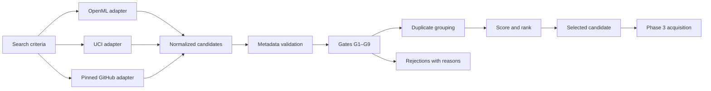

# ChurnWise AI — Autonomous Dataset Discovery (Phase 2)

| Field | Value |
| --- | --- |
| Status | Implemented and live-verified |
| Version | 1.0 |
| Date | 2026-10-20 |
| Scope | Discovery and candidate assessment only. No dataset is downloaded, hashed, cached or cleaned here. |
| Related | [ARCHITECTURE.md](ARCHITECTURE.md) · [ROADMAP.md](ROADMAP.md) · [ACCEPTANCE_CRITERIA.md](ACCEPTANCE_CRITERIA.md) · [PHASE2_REPORT.md](PHASE2_REPORT.md) |

---

## 1. What this subsystem does

A first-time user runs:

```bash
python -m churnwise.cli discover
```

No dataset, URL or credential is required. The engine queries public catalogs, normalizes their metadata into one candidate structure, rejects unsuitable or unverifiable datasets with reasons, collapses duplicate listings, scores what remains, and returns one recommended candidate — or a structured failure explaining what was tried and what to do next.

Discovery deliberately stops at metadata. The dataset file itself is fetched, hashed and cached in Phase 3.



---

## 2. Supported sources

| Source | Access method | Auth | Trust | Licence posture | Observed behaviour |
| --- | --- | --- | --- | --- | --- |
| OpenML (`openml`) | REST JSON: `/api/v1/json/data/list/data_name/{term}/limit/{n}`, `/data/{id}`, `/data/qualities/{id}`, `/data/features/{id}` | none | 1.00 | per-dataset `licence` field | An empty name search returns **HTTP 412 with error code 372 "No results"**; treated as an empty term, not a failure. Name search is effectively single-token: encoding spaces yields "No results". |
| UCI (`uci`) | REST JSON: `/api/datasets/list?search={term}`, `/api/dataset?id={id}` | none | 0.95 | **not exposed** by the API | Exposes `target_col`, variable roles/types, `data_url`, DOI and row/feature counts. No licence and no class balance. |
| GitHub pinned (`github-ibm`) | Fixed `api.github.com/repos/...` metadata + a pinned raw file URL | none | 0.70 | repository licence ≠ dataset licence | Unauthenticated API commonly returns **HTTP 403**; the adapter degrades to `unverified` and records a note. Dataset shape/target are unknown until download (and Phase 4 validation). |

Sources that would require credentials (e.g. Kaggle) are intentionally **not** implemented: a first run must never depend on a token. The registry is a reviewed list, not a web crawl.

---

## 3. Search configuration

`SearchQuery` (in `churnwise/contracts.py`) is validated before any request. Invalid configuration produces `CW-DISC-004` and no network traffic.

| Field | Default | Meaning |
| --- | --- | --- |
| `terms` | `churn`, `customer churn`, `attrition` | 1–6 unique terms, 2–64 chars, no control characters |
| `formats` | csv, tsv, arff, parquet, xlsx, zip | Accepted declared formats |
| `min_rows` | 1000 | Minimum rows for gate G2 |
| `max_rows` | none | Optional upper bound |
| `min_predictors` | 5 | Minimum predictor columns for gate G5 (1–100) |
| `require_numeric_features` | false | Fail G5 unless a numeric feature is explicitly confirmed |
| `require_categorical_features` | false | Fail G5 unless a categorical feature is explicitly confirmed |
| `require_customer_features` | false | Fail G5 unless a non-target column matches a customer-domain hint |
| `max_results_per_source` | 10 | Results requested per search term |
| `enrich_limit` | 12 | Maximum datasets enriched per source |
| `timeout_s` | 12 | Per-request timeout |
| `max_retries` | 2 | Retries for timeouts/429/5xx |
| `max_requests_per_source` | 30 | Hard request budget per adapter |
| `allow_unverified_license` | false | Accept candidates whose licence is not verified |

CLI equivalents: `--term` (repeatable), `--min-rows`, `--max-rows`, `--min-predictors`, `--require-numeric`, `--require-categorical`, `--require-customer-features`, `--limit`, `--enrich-limit`, `--timeout`, `--retries`, `--max-requests`, `--allow-unverified-license`, `--offline`, `--report-dir`, `--json`, `--verbose`, `--log-file`.

Environment overrides (all optional): `CHURNWISE_REPORT_DIR`, `CHURNWISE_DATA_DIR`, `CHURNWISE_ARTIFACT_DIR`, `CHURNWISE_HTTP_TIMEOUT_S`, `CHURNWISE_MAX_RETRIES`, `CHURNWISE_MAX_RESPONSE_BYTES`, `CHURNWISE_ALLOW_UNVERIFIED_LICENSE`, `CHURNWISE_OFFLINE`, `CHURNWISE_USER_AGENT`, `CHURNWISE_SEED`.

---

## 4. Candidate metadata contract

Every adapter produces the same `DatasetCandidate` (`schema_version` 1.0). Unknown metadata is represented as `null` — never guessed.

| Field | Notes |
| --- | --- |
| `candidate_id` | Stable `source:dataset_id` (e.g. `openml:46915`) |
| `source_id`, `source_name`, `source_dataset_id` | Provenance of the listing |
| `title`, `description` | Description trimmed to 800 characters, not summarized |
| `landing_url`, `resource_url` | Absolute HTTPS URLs; resource may be `null` if the source does not expose one |
| `format` | Canonical: csv, tsv, arff, parquet, xlsx, zip, json, or unknown |
| `publisher` | Only when the source declares one |
| `license` | `{name, url, status}`; status is `verified`, `unverified`, `restricted` or `unknown` |
| `published_at`, `updated_at`, `retrieved_at` | ISO-8601; `retrieved_at` is UTC |
| `size_bytes` | Only when the source reports it (none currently do) |
| `row_count`, `feature_count` | Source-reported, not inferred from data |
| `target_column`, `target_class_count` | Target evidence; class count from declared classes or nominal values |
| `class_balance` | `{majority, minority}` aggregate sizes when reported |
| `schema_fields` | `FieldInfo(name, data_type, role, missing_count)`; roles: target, id, feature |
| `has_numeric`, `has_categorical` | Derived from declared field types; `null` when no schema |
| `access` | `open` or `credential-required` |
| `limitations` | Human-readable caveats, including missing licence/balance/schema |
| `evidence` | Compact source payload excerpts (IDs, quality values, DOIs) so claims can be checked |

### 4.1 Metadata validation

Errors block a candidate; warnings are preserved.

| Code | Meaning | Severity |
| --- | --- | --- |
| C001–C006 | Bad identifier, empty title/source, non-HTTPS URL, unparseable timestamp | error |
| C007–C010 | Non-positive row/feature/size counts, target class count < 2 | error |
| C011–C012 | Malformed or non-positive class balance | error |
| C013 | Class balance does not sum to `row_count` | warning |
| C014 | Unsupported/unknown format | warning |
| C015 | Licence marked verified with no licence name | warning |
| C016 | Empty schema field name | error |

Rejected candidates are written to `reports/acquisition/rejections.json` with the failing codes; they never silently disappear.

---

## 5. Gates

| Gate | Question | Pass | Blocking when unknown |
| --- | --- | --- | --- |
| G1 `supported_format` | Is the declared format usable? | Format in `SearchQuery.formats` | yes |
| G2 `minimum_rows` | Is it big enough? | `min_rows ≤ rows ≤ max_rows` | yes |
| G3 `binary_target_identified` | Is there a declared 2-class target? | Target column and class count = 2 | yes |
| G4 `class_balance_in_range` | Is the minority class 2–50%? | Rate within range | **no** — Phase 4 verifies |
| G5 `sufficient_predictors` | Are there enough usable predictors? | `feature_count − 1 − id_columns ≥ min_predictors`; optional numeric/categorical/customer-feature requirements | yes |
| G6 `licence_policy` | May we use it? | Verified, or explicit opt-in for unverified | yes |
| G7 `no_direct_pii` | Any obvious PII column? | No name/email/phone/address-style columns | yes |
| G8 `download_size_within_cap` | Is it ≤ 200 MB? | Size known and within cap | **no** — Phase 3 enforces |
| G9 `source_metadata_available` | Did metadata retrieval succeed? | Candidate exists | yes |

**Eligibility:** no gate may fail, and no *blocking* gate may be `unknown`. Unknown is allowed only for G4 and G8, where the missing evidence is produced by later phases and the limitation is recorded.

`G5` subtracts the target from the source's feature count and also subtracts fields declared with role `id` when schema metadata is present. The minimum is configurable (`min_predictors`, default 5); `require_numeric_features`, `require_categorical_features` and `require_customer_features` turn an unconfirmed type or domain signal into a G5 failure rather than a scoring penalty.

---

## 6. Ranking

```text
score = 0.40 · target_confidence
      + 0.20 · schema_fit
      + 0.15 · licence_clarity
      + 0.15 · source_trust
      + 0.10 · size_adequacy
```

| Component | Definition |
| --- | --- |
| `target_confidence` | +0.40 target declared, +0.35 binary cardinality known, +0.15 churn-like target name, +0.10 class balance known (capped at 1.0) |
| `schema_fit` | 0.40 × min(predictors/30, 1) + 0.25 numeric features + 0.15 categorical features + 0.10 column metadata present + 0.10 customer-domain column signal (tenure, contract, subscription, charge, usage, account, plan, payment, balance, customer) |
| `licence_clarity` | verified 1.00 · unverified 0.25 · unknown 0.10 · restricted 0.00 |
| `source_trust` | OpenML 1.00 · UCI 0.95 · GitHub pinned 0.70 |
| `size_adequacy` | unknown 0.30 · below minimum 0.00 · ≤ 500k rows 1.00 · larger 0.70 |

Scores are relative within one discovery run; they are **not** a quality claim. Phase 4 validates the data.

**Tie-breaking** is deterministic: descending score, then source priority (`openml` 1, `uci` 2, `github-ibm` 3), then ascending `candidate_id`. Reordering adapter results cannot change the ranking.

Worked example from the live run: `openml:46915` scored **0.970667** — target 1.00, schema 0.853333 (19 predictors, numeric + categorical, schema present, domain columns such as `account_length`), licence 1.00, trust 1.00, size 1.00.

---

## 7. Duplicate handling

Sources re-publish the same corpus. Counting each listing as an independent option overstates choice, so candidates are grouped when metadata indicates the same underlying dataset:

1. same source + same normalized title + same row count;
2. same row count, feature counts within 1, and minority-class rates within 1 percentage point;
3. same row count, feature count and target name;
4. identical metadata fingerprint.

The representative is chosen by: eligible first, then highest score, then source priority, then candidate ID. Other members are marked `duplicate_of` with the matching reasons and excluded from ranking and selection. Groups are reported in `candidates.json`.

Live example: OpenML `40701`, `45076` and `46915` are versions of one 5,000-row corpus (21/21/20 columns; identical 4,293/707 class split where reported). They collapse to `46915` (MIT licence, complete metadata); the other two appear as duplicates rather than as independent fallbacks.

This is metadata-only inference. A false positive is visible in the report and can be overridden by changing the rules — it is not hidden.

---

## 8. Selection and failure behaviour

Candidate metadata validation lives in `churnwise/discovery/validation.py` and recommendation selection in `churnwise/discovery/selection.py`; the coordinator only sequences them. The selected candidate is the highest-scoring **eligible** candidate. If none is eligible, discovery fails — it never falls back to a convenient but unrelated dataset.

| Code | Meaning | Next action |
| --- | --- | --- |
| `CW-DISC-001` | Every configured source failed | Check network and retry; inspect per-source errors |
| `CW-DISC-002` | No usable candidate (empty or all invalid) | Broaden terms; verify sources |
| `CW-DISC-003` | Candidates found, none eligible | Inspect rejections; opt in to unverified licence only if that is the sole blocker |
| `CW-DISC-004` | Invalid configuration | Correct the reported fields |
| `CW-DISC-005` | Offline mode | Re-run with network access |
| `CW-DISC-006` | No sources enabled | Enable a source in the registry |

Source-level codes: `CW-SRC-001` timeout/connection, `-002` HTTP error, `-003` malformed payload or total enrichment failure, `-004` rate limited, `-005` request budget exhausted, `-006` response too large, `-007` unsafe URL, `-008` unexpected adapter error.

A failed source never reads as a successful empty search: if search returned hits but every metadata enrichment failed, the source is reported as `error`.

Reports are written atomically to `reports/acquisition/candidates.json` and `reports/acquisition/rejections.json`, including on failure.

---

## 9. Network and security

- **HTTPS only**, per-source host allowlist (`www.openml.org`, `archive.ics.uci.edu`, `raw.githubusercontent.com`, `api.github.com`, `github.com`), port 443, no embedded credentials.
- **Redirects** are followed manually (max 3); every hop is re-validated against the allowlist.
- **Size caps**: 200 MB declared-download cap (gate G8) and a 2 MB cap on metadata responses.
- **Request budget** per source (default 30) prevents runaway discovery.
- **Retries**: timeouts, connection failures, 429 and 5xx only; bounded exponential backoff; `Retry-After` honoured up to 10 s. 4xx is never retried.
- **No credentials** are used or stored; GitHub is unauthenticated, and a 403 is handled gracefully.
- **No dataset download**, extraction or execution happens in this phase. `resource_url` is recorded, not fetched.
- Source-provided URLs (UCI `data_url`) are validated for scheme and host before being stored.
- Logs are structured JSONL with identifiers and counts only; no PII or secrets.

---

## 10. Phase 3 hand-off

`SelectedCandidate.to_dict()` is the stable contract:

```json
{
  "candidate_id": "openml:46915",
  "source_id": "openml",
  "source_dataset_id": "46915",
  "title": "churn",
  "landing_url": "https://www.openml.org/d/46915",
  "resource_url": "https://www.openml.org/data/v1/download/22125226",
  "format": "arff",
  "license": {"name": "MIT License", "url": null, "status": "verified"},
  "target_column": "CustomerChurned",
  "row_count": 5000,
  "feature_count": 20,
  "retrieved_at": "2026-10-20T16:32:54Z",
  "limitations": [],
  "snapshot": { "...": "full candidate metadata at selection time" }
}
```

Phase 3 implements this hand-off: it downloads `resource_url` over the allowlist, verifies SHA-256 and any publisher checksum, writes the `DatasetManifest`, caches by content hash, and falls back to the next ranked candidate on failure. It does not silently accept a different dataset. The result and manifest contracts are in [ACQUISITION.md](ACQUISITION.md); Phase 3 evidence is in [PHASE3_REPORT.md](PHASE3_REPORT.md).

---

## 11. Testing

```bash
# mocked, deterministic, no network
.venv/Scripts/python -m pytest -q

# real sources, opt-in
.venv/Scripts/python -m pytest -m live --run-live -q
```

Mocked tests cover adapter parsing, empty and malformed responses, partial enrichment failures, PII detection, every gate, eligibility, scoring, duplicate grouping, ranking determinism, coordinator failure modes, report shape, CLI exit codes, and the OpenML 412/"No results" quirk. Live tests cover OpenML, UCI and a full coordinator run against real APIs.

Current results are recorded in [PHASE2_REPORT.md](PHASE2_REPORT.md#7-tests-and-results). Mocked tests prove adapter logic; only live tests prove real-source behaviour, and they are reported separately.

### Adding a source

1. Add a `SourceSpec` to `churnwise/discovery/registry.py` with hosts, trust and licence posture.
2. Implement `SourceAdapter._discover()` returning normalized candidates plus notes.
3. Register the adapter key in `churnwise/discovery/__init__.py`.
4. Add mocked tests for success, empty, malformed, partial and unsafe responses.
5. Add a live test only if the source is stable and permitted.

---

## 12. Known limitations

- **OpenML name search is single-token.** Multi-word terms return "No results" (handled), so recall comes from multiple one-word terms and explicit dataset IDs, not phrase search.
- **Only one eligible candidate by default.** UCI's licence is not exposed and GitHub's dataset shape is unknown pre-download, so both are rejected unless `--allow-unverified-license` is used (and GitHub still fails G2/G3).
- **No discovery cache.** Every discovery run re-queries sources; Phase 3's content-addressed cache covers acquired dataset artifacts, not search metadata.
- **Metadata-only dedupe.** Shape/title/balance heuristics can mis-group datasets; reasons are reported for review.
- **Latency.** OpenML metadata is slow and variable in practice (roughly 3–4 s per request); observed live runs took 41–56 s.
- **No parallel fetching.** Sequential requests keep rate-limit behaviour predictable.
- **GitHub API is rate-limited without a token**, so its licence evidence is often unavailable; the adapter stays honest about that.
