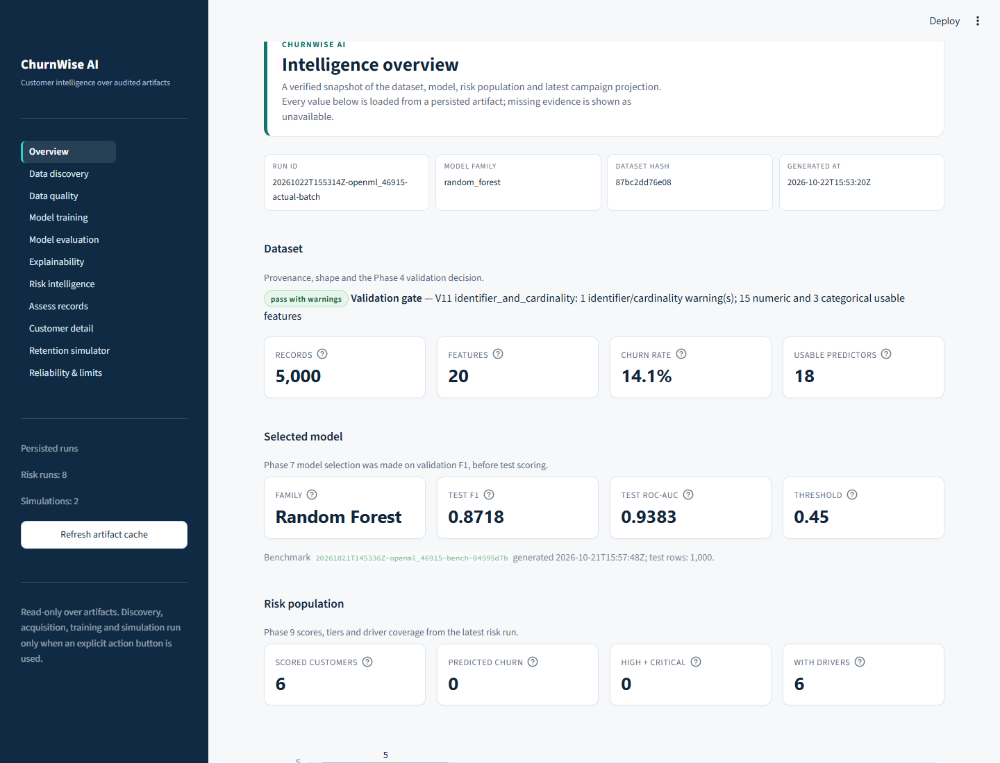
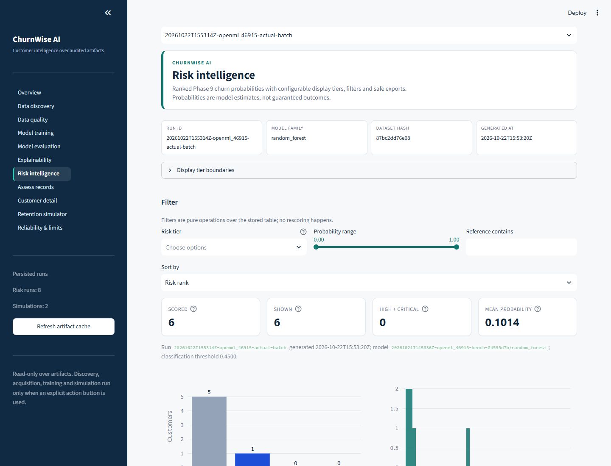
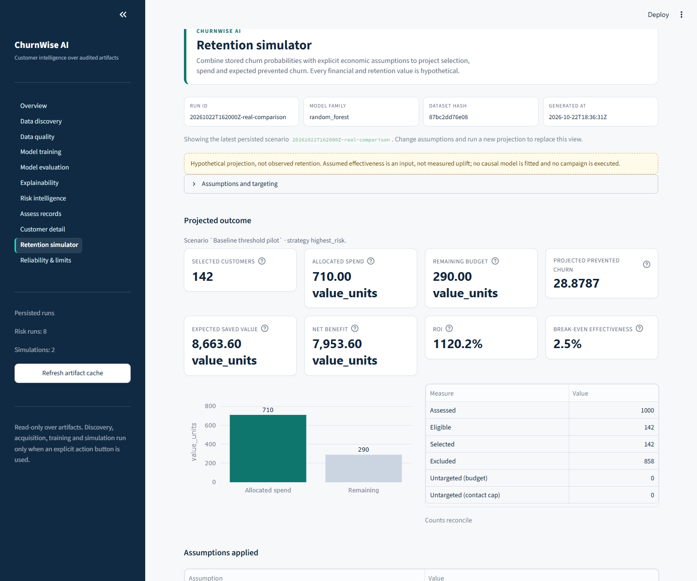
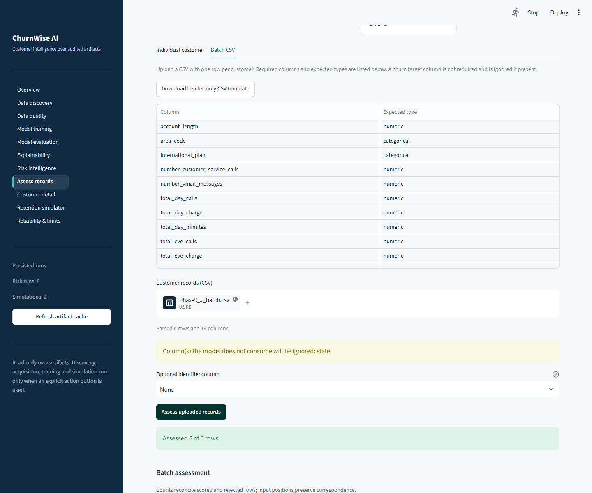

# Phase 11 Report — Interactive Intelligence Dashboard

Status: **implemented and verified; superseded only by the Phase 13 final
verification, which re-ran the dashboard against the final pipeline artifacts.**
This report records the Phase 11 evidence. Phase 12 orchestration and Phase 13
verification subsequently landed; see [PHASE12_REPORT.md](PHASE12_REPORT.md) and
[FINAL_VERIFICATION_REPORT.md](FINAL_VERIFICATION_REPORT.md).

> The dashboard reads stored artifacts and calls the existing phase services
> only from explicitly labelled actions. It does not include sample metrics,
> fabricated training curves, synthetic customers or simulated retention
> presented as observed results.

## 1. Implemented pages and navigation

The single Streamlit process exposes eleven pages through the sidebar:

| # | Label | Purpose |
| --- | --- | --- |
| 1 | Overview | Dataset, validation gate, selected model, latest risk population, latest campaign projection, evidence inventory |
| 2 | Data discovery | Phase 2 ranked candidates, gates, licence status, discovery action, acquisition action with optional lower-ranked fallback, attempt log |
| 3 | Data quality | Validation status, dimensions, missingness, duplicates, target balance, checks, roles, leakage risks, EDA profile |
| 4 | Model training | Prepared-dataset summary, latest MLP metadata/history, validated configuration form, explicit synchronous training action |
| 5 | Model evaluation | Validation vs test table, all three families, ROC/PR curves, confusion matrices, CV stability, limitations |
| 6 | Explainability | Global grouped importance, stored beeswarm/dependence figures, selected local explanation with contributions |
| 7 | Risk intelligence | Ranked stored table, configurable display tier boundaries, probability/tier/reference filters, sorting, pagination, CSV/JSON exports |
| 8 | Assess records | Individual schema-driven record scoring and batch CSV scoring through Phase 9; optional identifier hashing; rejection and export handling |
| 9 | Customer detail | Stored score/tier/rank, attached drivers, probability-matched local SHAP, assessment JSON export |
| 10 | Retention simulator | Budget/cost/effectiveness/horizon, four targeting strategies, tiers and contact caps, scenario comparison, sensitivity, selected customers |
| 11 | Reliability & limits | Artifact inventory, digest verification action, failed checks, warnings, limitations, privacy/cache behavior |

Every page header renders run id, model family, dataset hash prefix and
generated-at timestamp. Missing identity fields are labelled `not available`.

## 2. Visual and interaction decisions

- Native Streamlit layout and widgets, with a small CSS layer for typography,
  metric cards, section headers, status pills, empty states and a dark sidebar.
- White/ink/teal palette with blue, amber and red reserved for distinct
  statuses; labels and text carry the same information as color.
- Plotly figures use explicit axes, units and legends. Confusion matrices print
  counts, not color alone. Empty chart payloads render a text explanation.
- Numeric formatting is centralized: probabilities to four decimals, percentages
  with one decimal, counts with thousands separators, and money followed by the
  scenario's value unit. Undefined financial values display `undefined`.
- Long-running actions show a spinner and state plainly that training is
  synchronous. No fake progress bar or synthetic learning curve is rendered.
- Metric cards wrap long labels and values instead of clipping them, and the
  sidebar uses a full-row selected state so the current page is obvious without
  relying on colour alone.
- Hypothetical simulation values carry a dashed amber disclaimer; model
  probabilities are labelled estimates, not outcomes.

## 3. Service integrations completed

| Area | Real interface | Integration |
| --- | --- | --- |
| Discovery | `churnwise.discovery.discover`, adapters, `write_reports` | Action writes `reports/acquisition/candidates.json`, cached by token |
| Acquisition | `AcquisitionCoordinator.acquire` | Preferred candidate plus lower-ranked eligible candidates; Phase 3 owns cache/fallback/attempts |
| Validation/EDA | Phase 4 JSON reports | Read-only cards, tables, class chart, report paths |
| Training | `PreprocessingCoordinator.load`, `MLPTrainer.train(persist=True)` | Validated form; explicit synchronous action; genuine metadata/history |
| Evaluation | Phase 7 `metrics.json`, `curves.json` | Tables, ROC/PR, confusion matrices, CV, validation/test separation |
| Explainability | Phase 8 global/manifest/local artifacts | Stored importance and images; local example selected by row position and probability check |
| Individual scoring | `RiskService.assess_customer` | Schema-driven fields; optional Phase 8 local drivers |
| Batch scoring | `RiskService.assess_batch` | CSV validation, hashed optional identifier, row-level rejections |
| Risk explorer | Stored Phase 9 Parquet/summary/manifest | Display tier re-derivation, filters, exports |
| Simulation | `SimulationService.run_scenario(include_sensitivity=True, persist=False)` | In-memory projection; persisted simulation artifacts read-only |
| Reliability | Risk run manifest, `file_sha256` | Digest check only when the user clicks |

No model fitting, SHAP computation, download or projection happens during an
ordinary render.

## 4. Available and unavailable features

Available and exercised:

- All eleven pages render with both synthetic fixture artifacts and the real
  project artifact tree.
- Missing-artifact states show a concrete CLI command.
- Risk tier filtering changes the table from six fixture rows to two critical
  rows; a rewritten Parquet invalidates the cache and the page shows five rows.
- Customer detail shows the stored probability `0.9000` for
  `fixture_ref_000` and the matching local explanation.
- Training success is invoked once per submit and not repeated by a rerun;
  invalid training configuration and discovery failure render structured,
  traceback-free errors.
- Individual and batch assessment wrappers match direct `RiskService` output
  for the same records. A missing batch column yields eight rejects, zero
  scores and the batch error.
- Batch upload validation covers size, parse failure, empty input and row limit.
- Simulation output matches a direct Phase 10 engine run for selected count,
  spend and expected prevented churn.
- The dashboard started under Streamlit 1.66.1 and the readiness probe received
  a successful HTTP response from `http://127.0.0.1:8507/`.
- Real-data browser inspection showed Overview with 5,000 records, 20 columns,
  14.1% churn, 18 usable predictors, Random Forest test F1 `0.8718`, ROC-AUC
  `0.9383`, threshold `0.45`; Risk intelligence with the latest six-row batch;
  and Assess records with 18 schema fields. An individual all-blank-except-
  `account_length=12` record was genuinely scored by the selected Random Forest
  as `0.0611` (low, retained), with 17 imputed values reported.
- Screenshots of all eleven pages were captured at 1440 px wide from the real
  artifact tree and are stored in `docs/screenshots/`.
- A real batch CSV was uploaded through the browser file picker and assessed
  through Phase 9: **6 of 6 rows scored**, with the result rendered on the page.

Not performed or unavailable:

- Live discovery and acquisition were not started during this verification;
  they would hit public sources and write new artifacts. Their integration is
  covered by action wiring, not a live Phase 11 network run.
- Training was not executed during verification because it would create a new
  MLP run. The page renders real prepared/model artifacts and the action path is
  tested with a fake trainer boundary plus real configuration validation.
- SHAP checkbox execution was not exercised in the live browser. The page reads
  stored real local explanations; the wrapper supports the existing Phase 8
  engine.
- No automated browser E2E suite is committed. Screenshots and browser actions
  were driven with a local Playwright script using system Chrome; Playwright is
  not a declared project dependency.
- Phase 13 measured the final real-artifact dashboard: first `AppTest` render
  **1.937 s**, HTTP 200 within 2 s, and all eleven pages rendered without
  exceptions. A browser performance harness was still not used; the 5 s budget
  is met by the measured render, not by a browser navigation trace.

## 5. State, caching and artifact management

- JSON/Parquet reads use `st.cache_data` keyed by path, `st_mtime_ns` and size.
- Sidebar **Refresh artifact cache** clears the cache; action success paths also
  clear it before rerunning.
- Session state is limited to UI results and messages: training outcome,
  individual/batch assessment, in-session simulation, notices and errors.
- A different batch file digest clears the previous batch result, so scores are
  not shown against a newly uploaded file.
- The dashboard resolves newest artifacts by run-directory timestamp and
  reports the artifact path under each section.
- Validation report resolution now excludes Phase 3 `attempts.json` and
  `candidates.json`, which can share `reports/validation/` with a newer mtime.
  This was found in browser verification and fixed with a regression test.

## 6. Startup and test commands

Start:

```bash
python -m streamlit run churnwise/dashboard/app.py
```

Headless verification used:

```bash
python -m streamlit run churnwise/dashboard/app.py \
  --server.headless true --server.address 127.0.0.1 --server.port 8507
```

Focused dashboard tests:

```bash
python -m pytest -q \
  tests/unit/test_dashboard_analytics.py \
  tests/unit/test_dashboard_assessment.py \
  tests/unit/test_dashboard_data_access.py \
  tests/integration/test_dashboard_apptest.py
```

Full suite:

```bash
python -m pytest -q
```

## 7. Actual test results

| Command | Result |
| --- | --- |
| Focused dashboard suite | **42 passed** in 39.59 s |
| Full suite | **589 passed, 7 skipped** in 184.46 s |

The seven skips are the opt-in live-network tests (`--run-live`): one
acquisition, four discovery, one preprocessing and one validation check.

Warnings observed: TensorFlow/gast deprecation warnings, Keras input-structure
warnings and a NumPy global-RNG warning in SHAP plotting. The Streamlit
`use_container_width` deprecation is resolved; no Streamlit warnings remain.
None caused a failure.

## 8. Evidence and screenshots

The running app was started headless on `http://127.0.0.1:8507/` against the real
artifact tree and captured with Chromium at 1440 px wide:

| Page | Screenshot |
| --- | --- |
| Overview | [phase11-overview.png](screenshots/phase11-overview.png) |
| Data discovery | [phase11-discovery.png](screenshots/phase11-discovery.png) |
| Data quality | [phase11-quality.png](screenshots/phase11-quality.png) |
| Model training | [phase11-training.png](screenshots/phase11-training.png) |
| Model evaluation | [phase11-evaluation.png](screenshots/phase11-evaluation.png) |
| Explainability | [phase11-explainability.png](screenshots/phase11-explainability.png) |
| Risk intelligence | [phase11-risk.png](screenshots/phase11-risk.png) |
| Assess records | [phase11-assessment.png](screenshots/phase11-assessment.png) |
| Batch assessment | [phase11-assessment-batch.png](screenshots/phase11-assessment-batch.png) |
| Customer detail | [phase11-customer.png](screenshots/phase11-customer.png) |
| Retention simulator | [phase11-simulator.png](screenshots/phase11-simulator.png) |
| Reliability & limits | [phase11-reliability.png](screenshots/phase11-reliability.png) |









The batch screenshot records a real upload of the six-row Phase 9 batch and the
message `Assessed 6 of 6 rows.` No screenshot contains sample data or a
fabricated metric.

## 9. Known issues and unverified acceptance criteria

1. **Cold-load target (<5 s)**: Phase 13 measured **1.937 s** for the first
   real-artifact `AppTest` render; a browser navigation trace is still absent.
2. **No committed browser E2E suite**: screenshots and the batch upload were
   exercised manually with Playwright, but uploads, downloads and multi-page
   clicks are not guarded by a CI browser test.
3. **Training is synchronous**: the page blocks while fitting and persisting.
   This is stated honestly; no background progress is simulated.
4. **Batch SHAP**: batch scoring intentionally does not compute explanations.
   Local SHAP remains a stored-artifact/customer-detail feature.
5. **Live discovery/acquisition**: not run in this phase. Source availability
   and licence behavior remain Phase 2/3 concerns.
6. **Cross-artifact snapshots**: Overview shows the newest artifact per stage.
   A simulation caption identifies its source risk run, which may differ from
   the “latest risk population” above it.

## 10. Verification boundary

Verified:

- Application startup and HTTP availability.
- All eleven pages render without exceptions with real artifacts.
- All eleven pages render actionable empty states with no artifacts.
- Risk filtering, cache invalidation, customer probability match, training
  action de-duplication, structured failures, assessment delegation, upload
  validation, simulation equivalence and analytics helpers.
- One genuine individual assessment and a real six-row batch upload/assessment
  through the running app.
- Screenshot evidence for all eleven pages, plus the batch result state.

Assumed or unverified:

- Live discovery/acquisition and full training through the UI.
- SHAP generation from the assessment checkbox.
- End-to-end workflow from an empty project to a populated dashboard in one
  session — subsequently verified by the Phase 12 pipeline (see
  [PHASE12_REPORT.md](PHASE12_REPORT.md)).
- An automated browser E2E suite.

Phase 11 evidence stops here. The cold-load budget was later measured at 1.937 s,
and the whole workflow was composed in Phases 12–13.
