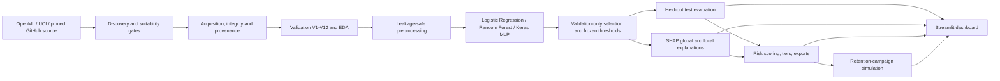

# ChurnWise AI — Technical Case Study

**A leakage-safe, artifact-first customer-churn workflow with an evaluated
dashboard and explicit evidence boundaries.**

ChurnWise AI is a local Python platform that discovers a public churn dataset,
acquires and validates it, trains and compares churn models, explains their
predictions, ranks a customer population and projects retention-campaign
scenarios. A Streamlit dashboard reads the persisted artifacts. The project is a
portfolio and research system, not a production service, and it does not claim
measured business impact or causal retention effects.

## 1. Problem and intended use

A churn prediction alone is not an operational decision. A reviewer needs to
know where the data came from, whether preprocessing leaked test information,
which model was selected and on what criterion, why a customer was ranked highly,
and which campaign numbers are measured versus assumed.

ChurnWise AI makes that chain explicit for:

- machine-learning and data-engineering portfolio reviewers;
- analysts who want a reproducible churn workflow over public data;
- reviewers evaluating leakage controls, evaluation discipline and
  explainability;
- anyone exploring budget-constrained retention scenarios under stated
  assumptions.

It is not intended for real customer data without additional governance,
privacy review, monitoring and validation.

## 2. System architecture

Every stage writes file artifacts with run IDs, configuration, timestamps and
provenance. A seven-stage orchestrator records each stage in
`artifacts/pipelines/<run-id>/run.json`. There is no database or backend
service. The file contract is what lets the dashboard and the CLI consume the
same evidence.

The main package boundaries are:

| Package | Responsibility |
| --- | --- |
| `churnwise.discovery` | Source adapters, suitability gates G1–G9, deterministic ranking |
| `churnwise.acquisition` | Allowlisted HTTPS download, integrity, cache, provenance |
| `churnwise.validation` | Target inference, 12 checks V1–V12, gate decision |
| `churnwise.eda` | Profile statistics and plots |
| `churnwise.preprocessing` | Split, train-only fitting, persisted pipeline and schema |
| `churnwise.models` | Keras MLP, training, baselines, registry and inference |
| `churnwise.evaluation` | Metrics, thresholds, fold-safe CV, reports and figures |
| `churnwise.explain` | SHAP explainers, grouping, global/local explanations |
| `churnwise.intelligence` | Risk service, tiers, ranking, drivers and exports |
| `churnwise.simulation` | Campaign assumptions, selection, budget and projections |
| `churnwise.dashboard` | Cached artifact loaders, five product pages and explicit actions |
| `churnwise.pipeline` | Orchestration, manifests, resume and cleanup |

## 3. Data acquisition and validation

The source registry declares three reviewed adapters: OpenML, the UCI Machine
Learning Repository and a pinned IBM sample on GitHub. Each has an allowlisted
host set and no credential requirement. The reference run selected OpenML
`46915`.

Discovery applies nine suitability gates:

1. supported format;
2. minimum rows;
3. identifiable binary target;
4. class balance;
5. sufficient predictors;
6. licence policy;
7. no direct PII;
8. download size within cap;
9. source metadata availability.

Candidates are deduplicated and ranked with a documented score. Unverified
licence metadata is rejected unless the user explicitly opts in. Acquisition
streams over allowlisted HTTPS, enforces size limits, verifies content and
SHA-256, stores bytes content-addressed and writes a provenance manifest. This
means a rerun can reuse a verified dataset without silently changing it.

The reference dataset is OpenML `46915`: 5,000 rows and 20 raw columns. Its
target is `CustomerChurned` with `No`/`Yes` labels, mapped to `0`/`1`, and a
14.14% positive rate. The verified dataset SHA-256 is
`87bc2dd76e08b5bffa37fdd97d3d418b41036fec3d4cbf7e31377542b8e85fb6`.
The OpenML licence is MIT.

Validation runs 12 checks covering file integrity, structure, target
identification, binary target, target interpretation, class balance, duplicate
columns, duplicate rows, missingness, low-information features, identifier and
cardinality risk, and target leakage. The gate can pass, pass with warnings or
block preprocessing. The reference dataset passed with warnings; the report
records the exact warnings rather than hiding them.

## 4. Leakage-safe preprocessing

The split is made before any learned transformation. The default protocol is a
stratified 60% / 20% / 20% train / validation / test split with seed 42,
producing 3,000 / 1,000 / 1,000 rows for the primary dataset.

All learned preprocessing is fitted on the training partition only:

- median imputation for numeric columns;
- a dedicated missing category for categorical columns;
- missing-value indicators when the training missing rate exceeds 1%;
- one-hot encoding with a maximum of 30 categorical levels;
- standard scaling;
- class weighting for the imbalanced target;
- derived features such as tenure bands and charge ratios.

The persisted pipeline, feature schema, split fingerprint and fitted
transformer are reused by evaluation, explanation, scoring and the dashboard.
The test partition is marked untouched during preprocessing. Cross-validation
refits the entire preprocessing plan within each fold after reconstructing the
base frame and verifying it against the Phase 5 matrices. Tests assert both the
split fingerprint and the no-leakage behavior.

## 5. Model comparison and selection

Three families are compared on the same split and transformed feature space:

- Logistic Regression as a linear, interpretable baseline;
- Random Forest as a non-linear tree ensemble;
- a Keras MLP with `[64, 32]` hidden layers, dropout, L2 regularization, Adam,
  binary cross-entropy, early stopping and checkpoint restore.

The selection metric is **validation F1**. A threshold is selected for each
family on validation predictions and frozen before the test split is scored.
The test split is evaluated once; it is not used to choose the family,
hyperparameters or threshold.

Reference benchmark result (held-out test, 1,000 rows):

| Family | Validation F1 | Test F1 | Test ROC-AUC | Test PR-AUC | Test Brier | Threshold |
| --- | ---: | ---: | ---: | ---: | ---: | ---: |
| Logistic Regression | 0.590476 | 0.635015 | 0.874107 | 0.571705 | 0.145961 | 0.64 |
| Random Forest **(selected)** | **0.798479** | **0.871795** | **0.938342** | **0.897321** | **0.039015** | **0.45** |
| MLP `[64, 32]` | 0.693727 | 0.720848 | 0.926642 | 0.780120 | 0.094439 | 0.73 |

Random Forest was selected on validation F1, not on its test result. Its test
confusion matrix was TN 846, FP 13, FN 22 and TP 119. Five-fold CV F1 was 0.818
± 0.023 for Random Forest, 0.713 ± 0.038 for the MLP and 0.552 ± 0.025 for
Logistic Regression at the reference 0.5 threshold. The Random Forest has a
visible train/validation overfitting gap (train F1 approximately 0.99), which is
reported rather than hidden.

The full-profile pipeline run `post13-full-20261024c` later reproduced these
held-out metrics exactly in all seven stages. The committed benchmark remains
the primary evidence.

## 6. Threshold selection and evaluation design

Thresholds maximize validation F1 for each family. The selected Random Forest
threshold is **0.45**, distinct from the risk-tier boundaries 0.30 / 0.50 / 0.70.
A tier is a business category, not a calibrated decision boundary.

Evaluation records:

- accuracy, precision, recall, specificity, F1, balanced accuracy and macro F1;
- ROC-AUC and PR-AUC;
- Brier score and log loss;
- confusion matrices at the frozen threshold;
- threshold sweeps and calibration views;
- fold-safe cross-validation estimates;
- the selection metric, selected family, threshold policy and a
  `test_evaluation_calls` counter.

The evaluation report can be regenerated from saved predictions without
refitting a model or rescoring the test rows. This is an important distinction:
the reported numbers are recomputable from evidence, not just copied from a
notebook.

## 7. Explainability and its limits

The explanation layer selects a family-specific explainer:

- `shap.TreeExplainer` for Random Forest, in probability space;
- `shap.LinearExplainer` for Logistic Regression, in log-odds space;
- `shap.DeepExplainer` for the Keras MLP, with a permutation fallback.

One-hot contributions are grouped back to source features so that a business
reviewer sees `Contract` rather than separate dummy columns. Additivity is
checked before values are reported. Explanation artifacts are tied to the
dataset hash, split fingerprint, preprocessing run and model digest. The test
partition is never used for SHAP.

Global rankings and local customer contributions are persisted. A separate
Phase 9 run wrote 1,000 local explanation files for 1,000 risk rows; the full
matrix is summarized in
[docs/evidence/explainability/matrix_1000_summary.json](evidence/explainability/matrix_1000_summary.json).

Two limits matter:

1. SHAP explains model behavior on transformed inputs. It does **not** establish
   that a feature causes churn.
2. Logistic Regression values are log-odds and are not numerically comparable
   with tree/MLP probability-space values.

## 8. Probability calibration experiment

A high ROC-AUC does not guarantee reliable probabilities. The post-Phase-13
calibration experiment tested sigmoid (Platt) and isotonic calibration against
the uncalibrated Random Forest.

The protocol was fixed before test evaluation:

1. Verify the stored validation and test probabilities against the persisted
   model (maximum absolute difference 0.0 for both).
2. Compare candidates with out-of-fold predictions inside the validation
   partition only, using 5 stratified folds.
3. Rank by out-of-fold Brier score, with log loss as the tie-break.
4. Fit the selected calibrator on the full validation partition.
5. Select an analysis threshold from validation out-of-fold F1.
6. Score test once with the frozen method and threshold.
7. Verify serialization and reload in a clean process.

Sigmoid won with validation Brier 0.046025, versus isotonic 0.047578 and
uncalibrated 0.051636. At the unchanged production threshold of 0.45, test
results were:

| Metric | Uncalibrated | Sigmoid | Change |
| --- | ---: | ---: | ---: |
| Brier ↓ | 0.039015 | 0.030555 | −0.008442 |
| Log loss ↓ | 0.168357 | 0.133686 | −0.034609 |
| ECE ↓ | 0.068607 | 0.030073 | −0.038534 |
| ROC-AUC | 0.938342 | 0.938342 | unchanged |
| PR-AUC | 0.897321 | 0.897321 | unchanged |

The paired bootstrap intervals for the Brier and log-loss improvements excluded
zero on this split. The analysis threshold was 0.46, but the production threshold
stayed 0.45. The calibrated estimator serializes and reloads, but it is **not**
integrated into the model registry, CLI, API or dashboard. That would require a
separate integration decision, versioning and re-validation. One validation split
also cannot establish subgroup calibration or calibration drift.

## 9. Second-dataset robustness experiment

To test whether the pipeline mechanics survive a different schema and domain,
the system was retrained on OpenML `42178`, the IBM Telco customer-churn sample:
7,043 rows, 21 columns, `Churn` target and 26.54% positive.

The native ARFF reader could not parse this file's OpenML `STRING` attributes.
An isolated experiment adapter converted the verified ARFF to CSV while
preserving rows, columns, values and order; the production reader was not
changed. Validation passed with warnings (11 missing cells and an identifier /
cardinality warning), and the 4,225 / 1,409 / 1,409 split used the same
leakage-safe preprocessing and validation-only selection policy.

| Family | Validation F1 | Test F1 | Test ROC-AUC | Test PR-AUC | Test Brier | Threshold |
| --- | ---: | ---: | ---: | ---: | ---: | ---: |
| Logistic Regression **(selected)** | **0.659574** | **0.619552** | **0.837960** | **0.651048** | **0.169109** | **0.61** |
| MLP `[64, 32]` | 0.653302 | 0.615569 | 0.834238 | 0.626959 | 0.169632 | 0.59 |
| Random Forest | 0.633028 | 0.606200 | 0.821257 | 0.618607 | 0.149806 | 0.39 |

All three families beat chance on the new held-out split, and the pipeline's
selection discipline survived. This is **not** evidence that the primary Random
Forest transfers to another customer population: these are new models trained on
a different dataset. The OpenML licence field says `Public` but provides no
licence URL, so reuse terms remain formally unverified.

## 10. Dashboard and user workflows

The Streamlit application has five product pages, arranged as one workflow:

1. **Executive Dashboard** — scored customers, predicted churn, risk
   distribution, dataset/model facts and priority customers.
2. **Customer Risk Explorer** — one stored assessment with drivers and a
   probability-matched explanation; explicit individual and batch scoring.
3. **Model Laboratory** — held-out performance, cross-validation stability,
   global SHAP, data quality/provenance and collapsed pipeline operations.
4. **Retention Workbench** — filters, ranking, budget-aware selection and
   contact-list export.
5. **Campaign Simulator** — hypothetical scenario comparison under explicit
   assumptions.

The dashboard reads persisted artifacts and never invents placeholder metrics.
Missing artifacts produce an actionable empty state with the command needed to
create them. Cache keys include path, modification time and size. Ordinary page
renders do not download, train, score or compute SHAP; discovery, acquisition,
training and scoring live behind explicit controls in Model Laboratory and the
scoring expanders.

The risk page filters by tier and risk, reconciles tier counts to the scored
population, and exports CSV/JSON/Parquet. CSV exports neutralize spreadsheet
formulas, exclude raw identifiers by default and stay inside the risk run's
artifact directory. Customer detail shows the probability, tier, rank and stored
signed drivers. The assessment page scores individual records and batch CSVs
through the same risk service and preprocessing pipeline; it does not duplicate
model logic in the UI.

The retention simulator applies a targeting rule, budget, cost per contact and
assumed effectiveness. It reports expected churn mass and expected prevented
churn as a projection, and returns `null` with a reason for saved value, net
benefit, ROI and break-even when no monthly value is supplied. It has no causal
model and does not observe retention.

## 11. Testing and reliability evidence

The project uses pytest with unit, integration and command-line tests. Live
network tests are marked `live` and the browser tests are marked `browser`; both
are opt-in.

| Suite | Result | Notes |
| --- | --- | --- |
| Default/offline | **634 passed, 17 skipped** | Post-audit rerun in 293.81 s; Phase 13 evidence remains 624 passed |
| Live network | **7 passed** | Requires `--run-live` and network |
| Browser E2E | **10 passed** in 78.33 s | Real Chromium-based browser and real Streamlit servers |

The browser suite covers all five pages, evaluation metrics, risk filtering from 6
to 2 critical rows plus a real CSV download, customer detail, simulator
projection, missing-model handling, individual assessment, batch upload/scoring
and export, and empty-artifact states.

Beyond tests, the pipeline has explicit failure semantics:

- configuration and dataset digests are checked on resume;
- missing artifacts invalidate a stage and every downstream stage;
- corrupt manifests are refused, not overwritten;
- structured error codes replace tracebacks for user-facing failures;
- cleanup is a dry run by default and deletes only run-owned paths;
- cross-phase assertions reject artifacts from different runs.

The full-profile run completed all seven stages in 328.259 s with a 613.9 MiB
peak. Three successful full-profile runs produced identical reported metrics,
but MLP weight bytes differed because TensorFlow op determinism is disabled.
This is statistical, not bitwise, reproducibility.

## 12. Engineering challenges and responses

**Leakage risk from a shared preprocessing object.** The split is created before
fitting, and every learned transformer is fitted only on training rows. CV
refits the plan per fold. Fingerprints make accidental changes visible.

**Different artifacts from different stages.** Each stage records dataset,
configuration and artifact identity. The risk service rejects stale or
mismatched model/preprocessing artifacts; the pipeline checks cross-phase
identity and resume validity.

**“The model with the best test score” selection.** The benchmark records a
validation-only selection rule and scores test once. Calibration follows the same
discipline, selecting the method on validation out-of-fold predictions.

**Explanations that look more authoritative than they are.** SHAP values are
grouped, checked for additivity, scoped to the exact model and dataset, and
labelled as model attributions rather than causal reasons.

**Simulation numbers that look like forecasts.** Assumptions are embedded in the
result, projections are explicitly hypothetical, and unsupported financial
metrics remain undefined.

**Dashboard honesty.** Pages read files, show empty states and expose actions
instead of fabricating numbers. Saved artifacts are audited on the Reliability
page.

**Browser testing without a live network.** The E2E suite uses temporary fixture
trees and its own Streamlit servers, forces offline mode, and selects free ports.
This makes the suite repeatable without external services.

## 13. Limitations and next steps

Current limitations:

- one primary dataset and one held-out split; no repeated-holdout variance or
  confidence intervals for the benchmark;
- no subgroup/fairness analysis or calibration-drift monitoring;
- calibration is evaluated but not integrated into production artifacts;
- the second-dataset experiment is robustness evidence, not external
  generalisation or model transfer;
- MLP results are not bitwise reproducible while TensorFlow op determinism is
  disabled;
- SHAP rankings are sample estimates and are not causal;
- risk tiers are business categories, not optimized or calibrated thresholds;
- the simulator has no measured uplift, causal model or observed retention
  outcome;
- the dashboard is local, single-user and synchronous during training;
- browser coverage is one engine and one desktop viewport; live actions,
  responsive layouts, accessibility and visual regression are not covered;
- the Windows/CPython 3.13 lock is platform-specific and has no hash pins.

Reasonable next steps, in order of evidentiary value:

1. add repeated stratified splits and subgroup metrics to quantify variance;
2. decide whether calibrated probabilities should become the production
   interface, then version and re-validate that integration;
3. add a schema/versioning registry for artifacts and a CI job that installs the
   lock and runs the offline suite;
4. expand the browser suite to a second engine and viewport, and add
   accessibility checks;
5. formalize licence/data-retention review before any reuse of secondary
   datasets.

None of these steps is required to reproduce the evidence described here.

## Related documentation

- [README](../README.md) — project overview and quick start
- [HOW_TO_RUN](HOW_TO_RUN.md) — installation, configuration, operation and troubleshooting
- [VALIDATION_SUMMARY](VALIDATION_SUMMARY.md) — curated post-Phase-13 evidence
- [ARCHITECTURE](ARCHITECTURE.md) — detailed module contracts
- [EVALUATION](EVALUATION.md) — metrics and threshold policy
- [EXPLAINABILITY](EXPLAINABILITY.md) — SHAP design and limits
- [RISK_INTELLIGENCE](RISK_INTELLIGENCE.md) — risk service and exports
- [SIMULATION](SIMULATION.md) — campaign assumptions and projection semantics
- [DASHBOARD](DASHBOARD.md) — page behavior and cache rules
