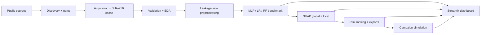
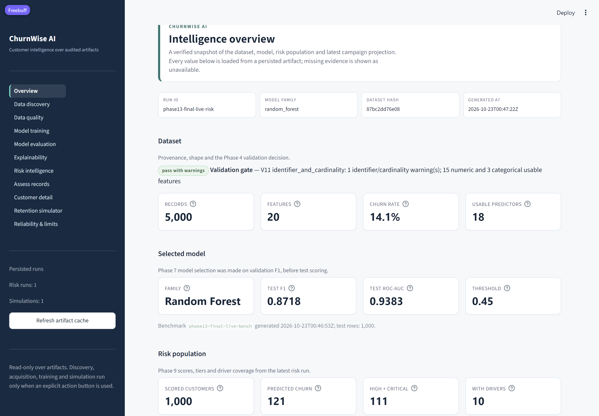

# ChurnWise AI — Project Presentation

**Audience:** technical reviewers, hiring managers, project stakeholders  
**Format:** 12-slide talk plus live demo; every number below is traceable to a saved artifact.  
**Status:** Phase 13 final verification complete, 2026-10-23.

---

## Slide 1 — The problem

Customer teams can predict churn, but a prediction alone does not answer the
operational questions:

- Which public dataset is suitable, and where did it come from?
- Can the same preprocessing and split be trusted for every model?
- Why did the model score this customer this way?
- Who should be contacted first, and what would a campaign plausibly change?
- Which claims are measured, and which are only assumptions?

ChurnWise AI is a local, artifact-first churn intelligence platform built to
answer those questions end to end without a database, backend service or cloud
account.

---

## Slide 2 — What was built

One local Python application with seven composable stages:

```text
discovery → acquisition → validation/EDA → preprocessing
          → MLP + Logistic Regression + Random Forest
          → SHAP explanations → risk ranking → campaign simulation
```

Plus:

- a single-command orchestrator with a durable run manifest and safe resume;
- a 11-page Streamlit dashboard over persisted artifacts;
- 624 passing tests, 7 opt-in live-network tests and a clean-environment
  dependency lock.

**Reference dataset:** OpenML `46915` — 5,000 rows, 20 raw columns, 14.14%
churn, MIT licence, SHA-256 `87bc2dd76e08b5bffa37fdd97d3d418b41036fec3d4cbf7e31377542b8e85fb6`.

---

## Slide 3 — Architecture and trust boundaries



- File artifacts are the contract; no database or service is required.
- The test split is scored once and never used for selection.
- The dashboard reads stored evidence and only runs services from explicit
  buttons.
- Every stage records a run ID, dataset hash, configuration and artifact paths.

---

## Slide 4 — Autonomous data path

**Discovery** searches OpenML, UCI and a pinned GitHub candidate through
allowlisted HTTPS, applies nine suitability gates, deduplicates versions, ranks
deterministically and writes candidate/rejection evidence.

**Acquisition** verifies size, content type, parser viability and SHA-256,
stores bytes content-addressed, writes a provenance manifest and supports
fallback across ranked candidates.

*Verified in Phase 13:* live acquisition of OpenML `46915`; 475,249 bytes,
SHA-256 recomputed and reused from cache. A first-time user supplies no dataset
or URL.

---

## Slide 5 — Data integrity and leakage controls

- Target detection normalised `CustomerChurned` `No/Yes` to `0/1`; positive
  rate **14.14%** from 5,000 rows.
- 15 numeric and 3 categorical usable predictors; high-cardinality `state` and
  identifier-like columns are excluded from model features.
- Stratified **3,000 / 1,000 / 1,000** train/validation/test rows with a recorded
  split fingerprint.
- Imputers, scaler, encoder and derived features are fitted on training rows
  only; cross-validation refits the full preprocessing plan per fold.
- The test partition is marked untouched during preprocessing and evaluated
  once (`test_evaluation_calls = 1`).

---

## Slide 6 — Models and measured results

Reference run `20261021T145336Z-openml_46915-bench-04595d7b`; thresholds chosen
on validation, then frozen before the single test evaluation.

| Family | Validation F1 | Test F1 | Test ROC-AUC | Test Brier |
| --- | ---: | ---: | ---: | ---: |
| Logistic Regression | 0.5905 | 0.6350 | 0.8741 | 0.1460 |
| Random Forest **(selected)** | **0.7985** | **0.8718** | **0.9383** | **0.0390** |
| MLP (Keras) | 0.6937 | 0.7208 | 0.9266 | 0.0944 |

- Selection used **validation F1 only**; the MLP was not assumed to win.
- 5-fold CV F1: RF **0.818 ± 0.023**, MLP **0.713 ± 0.038**, LR **0.552 ± 0.025**
  at the 0.5 reference threshold.
- Two Phase 13 fast live runs reproduced RF test F1 **0.8718** / ROC-AUC
  **0.9383** and LR **0.6350** / **0.8741** exactly; the MLP test F1 was
  **0.7068** on both. The deterministic RF fix did not change the results.

---

## Slide 7 — Explainability with SHAP

- Family-specific explainers: TreeSHAP for Random Forest, LinearSHAP for
  Logistic Regression, DeepSHAP for the Keras MLP.
- Global mean-|SHAP| rankings and signed local top drivers are persisted after
  grouping one-hot columns back to source features.
- Additivity is checked before values are reported; the final live run's local
  explanations had a maximum error of **8.06 × 10⁻¹⁵**.
- Full-population example: a 1,000-customer `explain=all` run wrote **1,000 local
  explanation files** tied to **1,000 risk rows**.
- Language is attribution, not causation: SHAP explains model behaviour, not
  churn reasons.

---

## Slide 8 — Risk intelligence

The selected Random Forest scores customers through the verified loader and
fitted preprocessing pipeline.

Reference Phase 9 run `20261022T155236Z-openml_46915-risk-final`:

- **1,000** validation customers scored, **0** rejected.
- Tiers: low **858**, medium **31**, high **40**, critical **71**.
- **121** predicted churn at the classification threshold **0.45**.
- Unique deterministic ranks, tier filters, pagination, CSV/JSON/Parquet
  exports, formula-injection guards and opaque references.
- **1,000** Phase 8 driver entries matched the 1,000 scored rows.

Probabilities are model estimates, not guaranteed outcomes; tier boundaries are
business-configurable, not calibrated decisions.

---

## Slide 9 — Retention simulation

A scenario applies an explicit targeting rule, budget, contact cost and assumed
effectiveness to Phase 9 probabilities.

Phase 13 live example (`phase13-final-live-sim`):

- assessed **1,000**, budget **1,000**, cost **5** per contact;
- selected **200**, allocated **1,000**, excluded **800** for budget exhaustion;
- expected churn mass **109.4446**, expected prevented churn **32.8334** at
  assumed effectiveness **0.30**;
- random-contact baseline **9.1385**, targeting lift **3.593**;
- no monthly value was supplied, so saved value, net benefit, ROI and
  break-even are `null` with reasons.

The simulation is a projection. It does not estimate causal uplift, execute a
campaign or observe retention.

---

## Slide 10 — Dashboard

Eleven pages: Overview, Data discovery, Data quality, Model training, Model
evaluation, Explainability, Risk intelligence, Assess records, Customer detail,
Retention simulator, Reliability & limits.

- Reads persisted artifacts; no placeholder metrics.
- Explicit actions only for discovery, acquisition, training, record assessment
  and simulation.
- Cache keys include path, modification time and size.
- Phase 13: all 11 pages rendered without exceptions; first real-artifact render
  **1.937 s**; HTTP 200 in under 2 s.



---

## Slide 11 — Reliability and reproducibility

- **624 passed, 7 skipped** (the skips are the documented opt-in live tests).
- **7/7** live-network tests passed when explicitly run.
- Fresh environment from `requirements.lock.txt`: dependency install and full
  suite reproduced.
- One-command live runs completed all seven stages in **66 s** (initial) and
  **105 s** (post-fix reproducibility run).
- 114/114 documentation checks passed.
- Resume, corrupt manifests, changed configuration, missing artifacts and
  rejected datasets have dedicated regression tests.

---

## Slide 12 — Limitations and responsible use

- The measured live evidence is the **fast profile**, not the full 150-epoch /
  5-fold production profile.
- Default MLP float identity is not bitwise reproducible; deterministic mode is
  tested separately. Random Forest now defaults to serial (`n_jobs=1`) execution
  so its predictions are bitwise stable.
- Artifact validation is distributed by phase, not a universal JSON-Schema
  registry.
- The dependency lock is Windows/CPython 3.13-specific and has no hash pins.
- No automated browser E2E suite; dashboard verification uses AppTest, HTTP and
  targeted browser screenshots.
- No causal claim from SHAP, no measured uplift, no production deployment or
  real customer retention outcome.
- Live evidence depends on external source availability and network conditions.

**Next steps:** browser E2E coverage, JSON-Schema registry, production-profile
timing, and a CI job that installs the lock and runs the suite.
