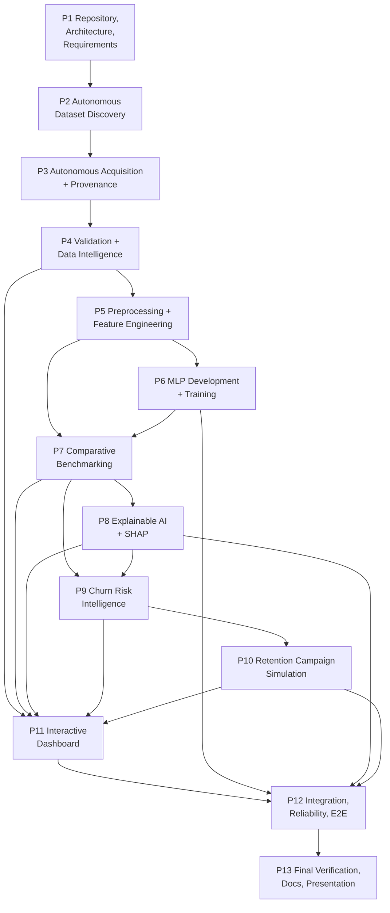

# ChurnWise AI — Implementation Roadmap

| Field | Value |
| --- | --- |
| Version | 1.0 (Phase 1 baseline) |
| Date | 2026-10-20 |
| Horizon | Five working days, 13 phases |
| Companion documents | [README.md](../README.md) · [ARCHITECTURE.md](ARCHITECTURE.md) · [ACCEPTANCE_CRITERIA.md](ACCEPTANCE_CRITERIA.md) · [PHASE1_REPORT.md](PHASE1_REPORT.md) |

This roadmap preserves **all thirteen phases**. No phase may be dropped, merged into another, or silently reduced. If a phase cannot be completed in the window, its remaining work and the resulting risk are recorded in [PHASE1_REPORT.md](PHASE1_REPORT.md) and in the phase's own completion report — the scope stays.

---

## 1. Phase dependency graph

**Critical path:** P1 → P2 → P3 → P4 → P5 → P6 → P7 → P8 → P9 → P11 → P12 → P13. P10 runs in parallel with P11 preparation; P11 (dashboard shell + data plumbing) can start once P4 artifacts exist, with pages filling in as P7–P10 land.

**Reading the graph.** It draws the critical path and the direct artifact feeds. P12 depends on every preceding phase and P13 on P12; those aggregate edges are omitted for legibility. P10's link to P4 is a capability dependency (a usable revenue proxy), not a file hand-off.

---

## 2. Five-day schedule

| Day | Planned hours | Work | Gate at end of day |
| --- | --- | --- | --- |
| 1 | 9 | P1 (3 h) → P2 (3 h) → P3 (3 h) | A verified dataset with manifest exists on disk and is reproducible from cache |
| 2 | 8.5 | P4 (3 h) → P5 (4 h) → P11 (1.5 h) | Validation gate passes; preprocessor + split fingerprint saved; dashboard shell reads real artifacts |
| 3 | 9 | P6 (4 h) → P7 (3 h) → P8 (1 h) → P11 (1 h) | MLP trained and early-stopped; benchmark from held-out metrics; overview + performance pages |
| 4 | 9 | P8 (3 h) → P9 (3 h) → P10 (2 h) → P11 (1 h) | Global/local SHAP working; ranked risk table; first scenarios; risk + explain pages |
| 5 | 5.5 | P10 (0.5 h) → P11 (0.5 h) → P12 (2.5 h) → P13 (2 h) | Full clean-room run passes; docs and presentation complete |

The dashboard track starts on Day 2 because it only *reads* Phase 4 artifacts; without that overlap, Day 5 would carry 11 h of work and the plan would not fit.

**Effort allocation (41 h total):** P1 3 h · P2 3 h · P3 3 h · P4 3 h · P5 4 h · P6 4 h · P7 3 h · P8 4 h · P9 3 h · P10 2.5 h · P11 4 h · P12 2.5 h · P13 2 h. Days 1–4 run 8.5–9 h and Day 5 is deliberately light at 5.5 h, so integration overruns have somewhere to land. Contingency is thin; Days 1–2 must not overrun. Mitigations are listed in §4.

---

## 3. Phase specifications

Each phase lists objective, scope, key artifacts, dependencies and exit gate. The testable completion criteria live in [ACCEPTANCE_CRITERIA.md](ACCEPTANCE_CRITERIA.md).

### Phase 1 — Repository, Architecture and Requirements

- **Objective:** establish the technical foundation, environment baseline, module boundaries, data contracts, autonomy requirements and acceptance criteria.
- **Scope in:** repository/environment audit, architecture, 13-phase roadmap, acceptance criteria, phase report.
- **Scope out:** application code, dependency installation, model training.
- **Artifacts:** `docs/ARCHITECTURE.md`, `docs/ROADMAP.md`, `docs/ACCEPTANCE_CRITERIA.md`, `docs/PHASE1_REPORT.md`, `.gitignore`, `requirements.txt`, `scripts/verify_phase1_docs.py`.
- **Dependencies:** none.
- **Exit gate:** docs consistent, all 13 phases represented with dependencies, autonomy declared mandatory, environment constraints documented with evidence.

### Phase 2 — Autonomous Dataset Discovery

- **Objective:** find suitable public churn datasets without any user-supplied file or URL.
- **Scope in:** source registry, OpenML/UCI/GitHub adapters, query plan, suitability gates G1–G9, deterministic scoring/ranking, rejection log, CLI `discover`.
- **Scope out:** downloading payloads (P3), schema validation of parsed data (P4).
- **Artifacts:** `churnwise/discovery/**`, `churnwise/net.py`, `churnwise/contracts.py`, `churnwise/cli.py`, `reports/acquisition/{candidates,rejections}.json`, `tests/test_*.py`, `docs/DISCOVERY.md`, `docs/PHASE2_REPORT.md`.
- **Dependencies:** P1 (contracts, registry design).
- **Exit gate:** a fresh run produces ≥1 ranked eligible candidate with recorded evidence, and ≥1 deliberately incompatible candidate is rejected with a reason.
- **Risks:** API shape drift; name-based search returning few hits (observed: OpenML name search for `telco` returned 0, while `churn` returned 3) — mitigation: multiple query terms, metadata resolution by ID, seed registry.

### Phase 3 — Autonomous Data Acquisition and Provenance

- **Objective:** download, verify, cache and record provenance for the selected dataset, with fallbacks and actionable failure.
- **Scope in:** allowlisted HTTPS downloader, size caps, redirect checks, content sniffing, parser probe, sha256, archive safety, content-addressed cache, manifest and attempt log, offline mode, fallback chain, error taxonomy.
- **Scope out:** schema/quality judgement (P4), training.
- **Artifacts:** `churnwise/acquisition/{downloader,integrity,store,provenance,coordinator,inputs,reporting}.py`, `data/{cache,raw,extracted,manifests,tmp}/**`, `reports/acquisition/attempts.json`, `tests/test_acquisition_*.py`, `tests/test_live_acquisition.py`, `docs/ACQUISITION.md`, `docs/PHASE3_REPORT.md`.
- **Dependencies:** P2 (selected candidate), P1 (manifest contract).
- **Exit gate:** a verified dataset file plus manifest exists; a corrupted-hash or tampered payload is rejected; an offline run with a warm cache succeeds and a cold cache fails with `CW-ACQ-005` and remediation; archives are inspected without unsafe extraction; no synthetic data appears anywhere.
- **Risks:** source availability, HTML-instead-of-CSV responses, checksum/size metadata being absent, licence ambiguity for the IBM mirror; mitigated by signature checks, local SHA-256 and explicit `unavailable` provenance.

### Phase 4 — Dataset Validation and Data Intelligence

- **Objective:** prove the acquired data is structurally usable and understand it before modelling.
- **Scope in:** schema checks, target detection/normalisation, role mapping to canonical schema, missingness/duplicates/constant/high-cardinality analysis, ID-like detection, leakage-risk flags, class balance, capability matrix, EDA profile and plots, JSON+Markdown reports, pass/fail gate.
- **Scope out:** imputation/scaling (P5), feature selection.
- **Artifacts:** `churnwise/validation/{loader,targets,checks,gate,report,coordinator,contracts}.py`, `churnwise/eda/{profile,plots}.py`, `reports/validation/<dataset_id>.{json,md}`, `reports/validation/attempts.json`, `reports/eda/*`, `tests/fixtures/mini_churn.csv`, `tests/unit/test_validation_checks.py`, `tests/integration/test_validation_gate.py`, `tests/test_validation_cli.py`, `tests/test_live_validation.py`, `docs/VALIDATION.md`, `docs/PHASE4_REPORT.md`.
- **Dependencies:** P3 (verified file + manifest).
- **Exit gate:** validation report with every check individually evidenced; fatal defects block training; EDA profile and capability matrix are consumable by P5.
- **Risks:** ambiguous target column names across sources; ARFF categorical encodings; class imbalance near a gate boundary.

### Phase 5 — Preprocessing and Feature Engineering

- **Objective:** build a leakage-safe, reproducible feature pipeline shared by all models.
- **Scope in:** stratified 60/20/20 split with fingerprint, role-driven ColumnTransformer (median/most-frequent imputation, StandardScaler, OneHotEncoder with unknown handling), capability-guarded derived features (tenure bands, charge ratios, service counts), fitted-artifact persistence with schema, imbalance strategy (class weights default, SMOTE opt-in fold-internal), leakage checklist enforcement.
- **Scope out:** model fitting.
- **Artifacts:** `churnwise/preprocessing/*`, `artifacts/splits/<run_id>.json`, `artifacts/preprocessors/<run_id>/{pipeline.joblib,schema.json}`, `tests/unit/test_preprocessing_leakage.py`, `tests/unit/test_split_determinism.py`.
- **Dependencies:** P4 (validated frame + profile).
- **Exit gate:** split fingerprint reproducible across runs; test statistics never influence fitted parameters (asserted by test); transformed matrix has identical column order for all consumers.
- **Risks:** high-cardinality categoricals, `TotalCharges`-style string-encoded numerics, derived-feature overreach on datasets missing source columns.
- **Implementation status (verified in [PHASE5_REPORT.md](PHASE5_REPORT.md)):** split, role-driven preprocessing, derived-feature guards, persistence, class weights and a training-only random oversampling option are implemented and tested. Fold-internal SMOTE is **not** implemented; the optional resampling path is seeded duplication of training rows. Live end-to-end verification is blocked by upstream discovery metadata, and the real-data evidence was produced offline from the verified Phase 4 artifact.

### Phase 6 — MLP Neural Network Development and Training

- **Objective:** implement and train the specified TensorFlow/Keras MLP with regularisation and early stopping.
- **Scope in:** model builder (ReLU, dropout, L2, sigmoid), BCE + Adam, class weights, callbacks, training loop, history capture, model/metadata persistence, seed control, CPU tuning.
- **Scope out:** benchmarking against baselines (P7), SHAP (P8).
- **Artifacts:** `churnwise/models/{mlp,trainer,registry,inference,reporting,contracts,errors}.py`, `artifacts/models/<run_id>/mlp/{model.keras,best.keras,metadata.json,history.json,learning_curves.png}`, `reports/models/<run_id>.{json,md}`, `tests/unit/{test_mlp_architecture,test_mlp_training,test_mlp_inference}.py`, `tests/integration/test_mlp_trains.py`.
- **Dependencies:** P5 (preprocessor + splits).
- **Exit gate:** MLP trains end-to-end, early stopping triggers or max epochs is reached, artifacts reload and reproduce identical predictions, architecture assertions hold (layer types, activations, loss, optimiser).
- **Risks:** TensorFlow install on cp313 Windows; nondeterminism; training-time overruns without early stopping.
- **Implementation status (verified in [PHASE6_REPORT.md](PHASE6_REPORT.md)):** the functional Keras MLP, validation-loss callbacks, best-checkpoint restoration, history/curves, digest-verified persistence, raw-record inference and CLI `train`/`predict` are implemented. A real run on the Phase 5 split completed 43/150 epochs in 11.75 s (best validation loss 0.365427 at epoch 31); focused tests passed 51/51 and the full suite 333 passed / 7 live-network skips. The test partition remains unevaluated; no performance claim is made before Phase 7.

### Phase 7 — Comparative Model Benchmarking and Evaluation

- **Objective:** evaluate MLP, Logistic Regression and Random Forest fairly on identical data and report real held-out metrics.
- **Scope in:** sklearn baselines, shared metric module, threshold policy, single test evaluation, 5-fold CV stability, confusion matrices, ROC/PR curves, benchmark table (JSON + Markdown), error slices, run manifest recording the shipped model.
- **Scope out:** hyperparameter search beyond the documented fixed configuration, SHAP.
- **Artifacts:** `churnwise/evaluation/*`, `churnwise/models/baselines.py`, `artifacts/evaluation/<run_id>/{metrics.json,benchmark.md,*.png}`, `tests/unit/test_metrics.py` (against sklearn reference), `tests/integration/test_benchmark_parity.py`.
- **Dependencies:** P6 (MLP), P5 (shared preprocessing/splits).
- **Exit gate:** all three families evaluated on the identical test row set and transformed matrix; every metric present and recomputable; confusion matrices reconcile with per-row predictions; no metric asserted without artifact evidence.
- **Risks:** fairness drift (different preprocessing), accidental test leakage, threshold confusion between validation and test.
- **Implementation status (verified in [PHASE7_REPORT.md](PHASE7_REPORT.md)):** LR/RF baselines, shared metrics, validation-only threshold selection (`fixed`/`max_f1`/`max_youden`/`recall_floor`), configurable validation-only model selection, 5-fold CV on train+validation, all figures and `--regenerate` from saved predictions are implemented. The reference run evaluated all three families once on the 1000-row test split (LR F1 0.6350 · RF F1 0.8718 · MLP F1 0.7208) and selected Random Forest on validation F1 0.7985; the MLP was not assumed to win. Focused tests 57/57, full suite 390 passed / 7 live-network skips. CV is fold-safe: preprocessing is refitted on each fold's training rows after the reconstructed base frame is verified against the persisted Phase 5 matrices — see [EVALUATION.md](EVALUATION.md#7-cross-validation).

### Phase 8 — Explainable AI and SHAP Integration

- **Objective:** explain global model behaviour and individual predictions with SHAP, for every model family.
- **Scope in:** explainer selection per family, background sampling, additivity verification, one-hot grouping to source features, global ranking + beeswarm, per-customer top-k signed contributions, precomputed JSON artifacts, runtime measurement.
- **Scope out:** counterfactual generation, causal claims.
- **Artifacts:** `churnwise/explain/*`, `artifacts/explanations/<run_id>/{global.json,importance.png,summary.png,dependence_*.png,run_manifest.json,local/*.json,local/*.png}`, `tests/unit/test_shap_{features,explainers,local,coordinator}.py`, `tests/integration/test_shap_mlp.py`.
- **Dependencies:** P6/P7 (trained models, preprocessor), P5 (feature names).
- **Exit gate:** additive consistency within tolerance; explanations exist for all scored customers used in the demo; grouped drivers reconcile to raw one-hot contributions; runtime within budget.
- **Risks:** `DeepExplainer` incompatibility with the Keras model shape; permutation fallback slowness on CPU; SHAP/numpy version friction.
- **Implementation status (verified in [PHASE8_REPORT.md](PHASE8_REPORT.md)):** family-specific explainers, explicit probability/log-odds spaces, additivity validation, one-hot grouping, seeded sampling, chunked batches, global/local artifacts, native SHAP figures, raw-record explanations and provenance are implemented. Real explanations were generated for all three families on the OpenML `46915` artifacts (RF 12.93 s, LR 2.52 s, MLP 7.19 s; max additivity error 1.05e-07). Focused tests 42/42 passed; full suite 432 passed / 7 live-network skips. Deep SHAP succeeded for the real MLP; the bounded permutation fallback is tested synthetically. Interface details: [EXPLAINABILITY.md](EXPLAINABILITY.md). Full-population driver persistence remains Phase 9 integration work, not a Phase 8 claim.

### Phase 9 — Customer Churn Risk Intelligence

- **Objective:** turn probabilities into an actionable, filterable, explainable risk list.
- **Scope in:** individual/batch scoring, tier derivation from configurable thresholds, deterministic ranking, value-at-risk ordering where a revenue proxy exists, segment filters, per-customer driver attachment, exports (CSV + JSON + Parquet), record-level rejection reconciliation.
- **Scope out:** campaign economics (P10), UI (P11).
- **Artifacts:** `churnwise/intelligence/{contracts,service,model,drivers,ranking,reporting,errors}.py`, `artifacts/predictions/<run_id>/{churn_scores.parquet,risk_summary.json,tiers.csv,run_manifest.json,drivers.json,rejections.json,exports/*}`, `tests/unit/test_ranking_tiers.py`, `tests/integration/test_scoring_counts.py`, `tests/test_risk_cli.py`.
- **Dependencies:** P7 (shipped model), P8 (drivers).
- **Exit gate:** every scored row has a probability in [0,1], a tier and a rank; tier counts sum to the scored population; ordering is stable and documented; value-at-risk ordering matches its formula; CSV/JSON exports round-trip and reject path escape.
- **Risks:** tie handling in ranks, threshold drift between config and UI, missing revenue proxy skewing value ordering, CSV formula injection, stale model/preprocessor reuse.
- **Implementation status (verified in [PHASE9_REPORT.md](PHASE9_REPORT.md)):** individual and batch assessment, tier configuration, deterministic ranking/filtering/pagination, Phase 8 driver attachment, CSV/JSON/Parquet exports, rejection records, provenance and artifact freshness checks are implemented. The real OpenML `46915` validation population produced 1,000 scores (16.96 s with 1,000 drivers) and 111 high/critical customers; a six-row real raw batch reproduced the stored population probabilities exactly. Focused risk tests 58/58 passed; full suite 490 passed / 7 live-network skips. Interface and limitations: [RISK_INTELLIGENCE.md](RISK_INTELLIGENCE.md).

### Phase 10 — Retention Campaign Simulation

- **Objective:** let a user size a campaign and see projected saves, cost, ROI, break-even and sensitivity — with assumptions explicit.
- **Scope in:** segment/targeting selection, assumption schema and defaults, projected outcome math, break-even guard, random-targeting baseline comparison, sensitivity grid, disclaimer propagation, scenario persistence.
- **Scope out:** causal uplift estimation, real message dispatch.
- **Artifacts:** `churnwise/simulation/*`, `artifacts/simulations/<scenario_id>/{result.json,sensitivity.csv}`, `tests/unit/test_campaign_math.py` (hand-computed cases), `tests/integration/test_simulation_assumptions.py`.
- **Dependencies:** P9 (ranked scores), P4 (revenue proxy availability).
- **Exit gate:** results match independently hand-computed expectations; every output carries its assumptions; zero-at-risk and zero-cost edge cases are handled without division errors; projections labelled as projections.
- **Risks:** users mistaking projections for measured uplift; revenue proxy absent for some datasets.
- **Implementation status (verified in [PHASE10_REPORT.md](PHASE10_REPORT.md)):** validated scenario/assumption schema with actionable `CW-SIM-*` failures, four targeting strategies with deterministic tie-breaking, budget and contact-limit enforcement (uniform and per-customer costs, zero-cost and zero-budget guards), expected prevented-churn and financial projections with explicit undefined metrics, assumption-visible scenario comparison, one-at-a-time sensitivity grids, Markdown/CSV/JSON reports, PNG charts, and persisted per-scenario artifacts are implemented. A genuine simulation on the real OpenML `46915` Phase 9 run (1,000 assessed customers) selected 142 customers at a 0.30 risk floor, spent 710 of a 1,000 budget and projected 28.8787 prevented churns at assumed effectiveness 0.30 (ROI 1120.22%, break-even effectiveness 2.46%) — labelled as a projection throughout. Focused simulation tests 57/57 passed (47 unit + 10 integration); full suite 547 passed / 7 live-network skips. Methodology and interface: [SIMULATION.md](SIMULATION.md).

### Phase 11 — Interactive Intelligence Dashboard

- **Objective:** deliver the complete seven-page Streamlit experience over stored artifacts.
- **Scope in:** navigation shell, artifact-access layer with caching, pages (Overview, Model performance, Explainability, Risk explorer, Customer detail, Campaign simulator, Reliability & limits), empty/error states, filters, exports, run-identity headers.
- **Scope out:** any training, acquisition or SHAP execution inside the UI process.
- **Artifacts:** `churnwise/dashboard/**`, `tests/integration/test_dashboard_apptest.py`, `scripts/run_dashboard.ps1` (or documented command), screenshots in `docs/`.
- **Dependencies:** P4, P7, P8, P9, P10 artifacts.
- **Exit gate:** app starts headless, every page renders with real artifacts, missing-artifact states are actionable, no placeholder numbers, `streamlit.testing.v1.AppTest` covers all pages.
- **Risks:** Streamlit version API drift, cache key mistakes serving stale metrics, slow SHAP payloads.

### Phase 12 — Integration, Reliability and End-to-End Testing

- **Objective:** prove the whole pipeline runs reproducibly from an empty data directory and is honest under failure.
- **Scope in:** `run` orchestrator, end-to-end test with network disabled on a committed fixture, contract tests for every JSON artifact, determinism test, failure-path tests (bad hash, incompatible schema, licence block, offline cold cache), import-boundary test, performance measurement, artifact cleanup tooling.
- **Scope out:** new features.
- **Artifacts:** `churnwise/pipeline.py`, `tests/integration/test_end_to_end.py`, `tests/test_contracts.py`, `tests/test_import_boundaries.py`, `reports/performance.md`, `docs/RUNBOOK.md`.
- **Dependencies:** P1–P11.
- **Exit gate:** single command reproduces the full artifact set; all contract and determinism tests pass; every failure path yields its documented error code; measured timings are reported against budget.
- **Risks:** TF/Streamlit startup overhead in tests, fixture-vs-real-data divergence, Windows path handling.

### Phase 13 — Final Verification, Documentation and Presentation

- **Objective:** verify every acceptance criterion with evidence and produce the final documentation and demo.
- **Scope in:** criteria-by-criteria verification table, final metrics summary (measured, with run IDs), limitation and ethics statement, README quick start, architecture/roadmap refresh, demo script and screenshots, cleanup of dead code and stale artifacts.
- **Scope out:** scope expansion.
- **Artifacts:** `docs/FINAL_VERIFICATION.md`, `docs/PRESENTATION.md`, `README.md`, refreshed architecture docs, demo assets.
- **Dependencies:** P12.
- **Exit gate:** every criterion in [ACCEPTANCE_CRITERIA.md](ACCEPTANCE_CRITERIA.md) marked pass/fail with a concrete artifact reference; no unresolved placeholder; a reviewer can reproduce the demo from a clean checkout in the documented steps.
- **Risks:** late documentation drift, over-claiming results, insufficient time for the presentation.

---

## 4. Schedule risks and mitigations

| Risk | Likelihood | Impact | Mitigation |
| --- | --- | --- | --- |
| TensorFlow install friction on Python 3.13/Windows | Medium | High (blocks P6) | Wheel availability already verified (2.20/2.21); isolated `.venv`; if install fails, fall back to a Python 3.12 venv and document it — never substitute a different framework silently |
| SHAP runtime on CPU for the MLP | Medium | Medium | Background ≤50 training rows and 60 explained rows by default; precomputed and chunked; bounded permutation fallback with a hard evaluation budget |
| Discovery returns thin results | Medium | Medium | Multi-term queries + seed registry + explicit candidate IDs; rejection log proves real evaluation |
| Licence ambiguity (IBM mirror) | High | Low–Medium | Record `unverified`, require explicit opt-in, prefer MIT/Public OpenML candidates |
| Streaming/UI work overruns Days 2–4 | Medium | High | Dashboard shell built on Day 2 once P4 artifacts exist; pages are thin readers; only 0.5 h of dashboard work is scheduled on Day 5 |
| Thin contingency in a 41 h plan (Days 1–4 at 8.5–9 h) | High | High | Cut polish, never scope: extra charts and cosmetics are the first things dropped; Day 5 absorbs overruns up to ~2.5 h; any unbuilt criterion is reported, not hidden |
| Determinism failures | Medium | Medium | Split fingerprint + seeded RNGs + optional op-determinism mode; determinism test in P12 |

---

## 5. Scope preservation statement

The following are **non-negotiable across the roadmap** and must remain true at Phase 13:

1. Autonomous dataset discovery and acquisition remain mandatory; a first-time user never supplies a dataset or URL.
2. All three model families (MLP, Logistic Regression, Random Forest) are trained, evaluated and reported.
3. SHAP explanations cover both global behaviour and individual predictions.
4. Risk ranking, filtering and campaign simulation are functional, not mocked.
5. The dashboard contains all seven pages and reads only real artifacts.
6. Every reported number is traceable to a run ID and an artifact; no fabricated or predetermined results.
7. No unnecessary infrastructure (database, backend service, auth, cloud) is introduced.
