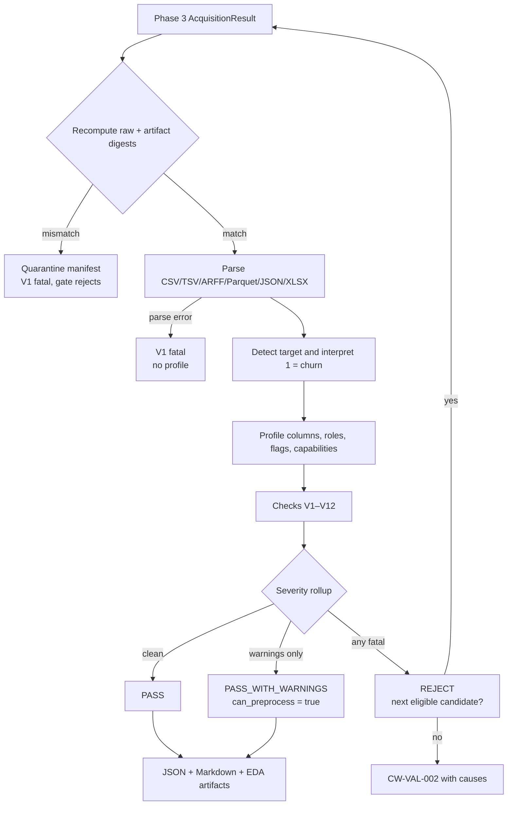

# ChurnWise AI — Dataset Validation and Data Intelligence (Phase 4)

Phase 4 decides whether the verified Phase 3 artifact is usable for supervised
customer-churn modelling. It verifies the artifact again, parses it, finds and
interprets the target, maps every column to an explicit role, runs twelve
individually evidenced checks, produces an EDA profile and plots, and returns a
gate decision. It never imputes, scales, encodes, splits rows or fits a model.

A validation report is descriptive evidence, not a promise of model quality.

---

## 1. Inputs and outputs

**Inputs**

- A successful Phase 3 `AcquisitionResult` (manifest + artifact), or the ranked
  Phase 2 candidates that Phase 4 re-acquires itself.
- `reports/acquisition/candidates.json`, used by the `validate` CLI when it has
  to discover or fall back to another eligible candidate.
- The managed `data/` directory: cache blob, raw copy, extracted member and
  manifest.

**Outputs**

- `reports/validation/<dataset_id>.json` — the complete `ValidationReport`.
- `reports/validation/<dataset_id>.md` — the human-readable report.
- `reports/validation/attempts.json` — every candidate tried and why it stopped.
- `reports/eda/<dataset_id>.json` — the `DatasetProfile`.
- `reports/eda/<dataset_id>*.png` — EDA figures.
- `data/manifests/<dataset_id>.profile.json` — archived profile for later stages.
- A `ValidationResult` carrying the report, profile, loaded frame, normalized
  frame accessor and the Phase 5 capability view.

An integrity failure quarantines the manifest (`data/manifests/quarantine/`) so a
corrupt artifact cannot be reused silently.

---

## 2. Flow



Candidate fallback is orchestrated by `ValidationCoordinator`, which calls the
Phase 3 coordinator one candidate at a time. It does not reimplement download,
integrity or cache logic.

---

## 3. Checks V1–V12

Every check records a stable id, a name, its declared severity, pass/fail, a
human detail, structured issues and machine-readable evidence. A check that
cannot be evaluated is marked plainly and never silently passes.

| ID | Check | Declared | Fails when | Recorded evidence |
| --- | --- | --- | --- | --- |
| V1 | `file_integrity_and_readability` | fatal | raw copy or artifact is missing, unreadable, has a digest mismatch, or the file cannot be parsed | expected and observed digests, format, source path |
| V2 | `structural_integrity` | fatal | zero rows, fewer than **100** rows, fewer than 2 columns; **1,000** rows or fewer is a warning | row/column counts |
| V3 | `target_identified` | fatal | no candidate reaches the detection threshold, or two strong targets are ambiguous | candidate list with scores and labels |
| V4 | `target_binary` | fatal | the selected target does not have exactly two observed classes | classes and counts |
| V5 | `target_interpretation` | fatal | the positive class cannot be mapped to churn with medium/high confidence | mapping, positive/negative label, method, confidence |
| V6 | `target_balance` | warning | positive rate is outside **2%–50%** | positive/observed counts and rate |
| V7 | `duplicate_columns` | warning | repeated headers, or two columns with identical content | duplicate header/column pairs |
| V8 | `duplicate_rows` | warning | exact duplicate rows exist | count and share |
| V9 | `missingness` | warning → fatal | target missing in **>20%** of rows (fatal); any missing cell, target missing ≤20%, a predictor >**50%** missing, or infinite numeric values (warning) | cell, target and per-column percentages; non-finite column list |
| V10 | `low_information_features` | warning | a predictor is constant or ≥**99.5%** one value | column list and unique counts |
| V11 | `identifier_and_cardinality` | warning → fatal | an ID-like column is excluded (warning), a categorical exceeds **30** levels (warning), no numeric predictor remains (warning); fatal when no usable predictor remains, or when fewer than **3** numeric predictors remain and no categorical feature does (the EDA stage gate) | id, numeric/categorical roles, dropped columns |
| V12 | `target_leakage` | warning | a column's name or values look post-outcome, duplicate/invert the target, or map deterministically to one class | column and reasons |

Thresholds live in `churnwise/validation/checks.py` and nowhere else. The
report's Markdown table is generated from the same objects, so no figure is
transcribed by hand.

### Severity rollup

- Any **fatal** failing check → `REJECT`; `can_preprocess = false`; training must
  not start. The blocking check ids are listed in `gate.blocking`.
- Only **warning** failures → `PASS_WITH_WARNINGS`; preprocessing may proceed, but
  the dataset is not silently treated as clean.
- No failures → `PASS`.

A check's severity comes from its issues, not from its declared maximum. For
example V2 is declared fatal because it can reject a dataset, but V2 on a
950-row dataset is a warning, so the gate remains open.

---

## 4. Target detection and normalisation

`detect_target` scores every column on name, observed labels, class count,
missingness and dataset context (title/description/Phase 2 target hint):

| Signal | Effect |
| --- | --- |
| name contains churn/attrition/cancel/exit/left/lost/terminated | strong positive |
| name contains retain/active/stayed/renewed/loyal | positive, class meaning inverted |
| neutral name (`target`, `label`, `class`, `y`, `outcome`) | weak positive; `1/Yes` is **not** assumed to mean churn |
| negative name (`reason`, `date`, `amount`, `score`, `id`, `name`, `email`) | excluded |
| exactly two observed classes | +0.30; known Yes/No-style labels +0.15 each way |
| ≤5% missing / >20% missing | +0.10 / −0.40 |

A column needs score **≥ 0.75** to be selected. Two strong binary churn-style
candidates within 0.15 of each other are reported as **ambiguous** and V3 fails
rather than guessing.

Interpretation is explicit about the positive class:

- `Yes/No`, `True/False`, `1/0`, `Y/N` → conventional positive is churn **only**
  when the column name is churn-style; retention-style names are inverted.
- Explicit labels (`Churned`/`Retained`, `Exited`/`Stayed`) are mapped by
  meaning.
- A churn-named `0/1` column is high confidence; a neutral-named `0/1` column is
  **low confidence** and V5 rejects it. The validator never claims semantics it
  cannot support.
- `normalize_target` maps to pandas nullable `Int64`: `1 = churned`, `0 = not
  churned`, and missing labels stay missing.

`ValidationResult.normalized_frame()` returns a copy with the target mapped and
rows with a missing target excluded. The acquired artifact is never modified;
the untouched frame remains available on the result.

---

## 5. Roles, flags and capability matrix

Every column receives exactly one role: `target`, `id`, `numeric`, `categorical`
or `dropped`. Dropped columns always carry a reason — additional identifier-like
columns, duplicate content, leakage risk, date/time, constant, >50% missing,
free-text, or more than 30 categories.

Flags are additive and each has a reason:

`id_like`, `constant`, `near_constant`, `high_missing`, `high_cardinality`,
`text_like`, `date_like`, `duplicate_column`, `leakage_risk`.

The capability matrix tells Phase 5 which derived features are safe to build.
Every entry records the source column that satisfied it, or `null`:

`has_tenure`, `has_monthly_charge`, `has_total_charges`, `has_contract`,
`has_payment_method`, `has_internet_service`, `has_support_calls`,
`has_usage_minutes`, `has_plan`, `has_senior_citizen`, `has_gender`,
`has_revenue_proxy`.

Capabilities are evidence about column names, not fitted statistics.

---

## 6. CLI

```bash
# Validate the acquired dataset; discover/acquire when nothing is cached yet.
python -m churnwise.cli validate

# Validate only verified cached artifacts. Never touches the network.
python -m churnwise.cli validate --offline

# Machine-readable result and a bounded fallback chain.
python -m churnwise.cli validate --offline --json --max-candidates 3
```

| Flag | Meaning |
| --- | --- |
| `--offline` | use only verified cached artifacts; cold cache produces an acquisition failure per candidate |
| `--max-candidates N` | stop after N eligible candidates (default 3, minimum 1) |
| `--refresh-discovery` | run Phase 2 discovery even when `candidates.json` exists |
| `--data-dir`, `--report-dir` | override managed directories |
| `--json` | print the full `ValidationResult` document (ASCII-escaped, so stdout survives any console codec) |
| `--verbose`, `--log-file` | structured JSONL diagnostics (no dataset values/paths beyond ids) |
| `--allow-unverified-license` | forward the licence policy to acquisition |

Exit codes: **0** = pass or pass-with-warnings; **2** = reject or structured
failure (`CW-VAL-001` no candidates, `CW-VAL-002` all rejected,
`CW-VAL-003` acquisition failed during validation); **3** = invalid settings or
an unwritable report directory.

`reports/validation/attempts.json` records every candidate: stage
(`acquisition` or `validation`), status, duration, error code, first blocking
check, report path and failure reasons. A fallback is never silent.

---

## 7. Report contents

The JSON report is self-identifying and safe to archive:

- `schema_version`, `dataset_id`, `generated_at`, `validator_version`
- `manifest_sha256`, `artifact_sha256`, `artifact_path`
- `status` and the complete `gate` object
- twelve `checks`, each with `issues` and `evidence`
- `summary` (shape, missingness, duplicates, target rate, feature roles, flags)
- `target` (column, classes, counts, mapping, positive label and rate, method,
  confidence, ambiguity, candidate scores)
- `roles` (target, id, numeric, categorical, dropped with reasons, capabilities)
- `capabilities`
- `provenance` (source, URL, licence status, retrieval time, run id, manifest
  path, acquisition attempt, rank, cache reuse, digests)

The Markdown report renders the same values plus links to the profile and plots.
Numeric values are recomputed from the actual frame; `tests/integration/
test_validation_gate.py` cross-checks them against independent pandas calls.

---

## 8. Verification

| ID | Check | Where |
| --- | --- | --- |
| T4.1 | every check has passing and failing fixtures | `tests/unit/test_validation_checks.py` |
| T4.2 | missing target / single class blocks the gate | unit and integration tests |
| T4.3 | `Yes/No`, `0/1`, `True/False` map to `1/0`; retention inverted | parametrised unit tests |
| T4.4 | identifier-like keys are flagged and excluded | integration test asserts `customerID` on the fixture artifact |
| T4.5 | fatal check blocks training end-to-end | `tests/integration/test_validation_gate.py` |
| T4.6 | report values match pandas recomputation | integration test and `tests/test_live_validation.py` |

The live test repeats discovery, acquisition and validation against the real
OpenML source and then rechecks the on-disk digest and the positive rate.

Measured at hand-off: `pytest -q` → 232 passed, 6 skipped; `pytest -q
--run-live` → 238 passed; `scripts/verify_phase1_docs.py` → 114/114.

---

## 9. Limits and deliberate decisions

- **No cleaning.** Missing values, outliers and category levels are reported,
  never changed. Phase 5 owns imputation and encoding.
- **No target guessing.** A neutral binary target stays low-confidence and is
  rejected. This can reject a genuinely usable dataset; the error is deliberate
  and visible in the V5 evidence.
- **Descriptive only.** Correlation and target-conditional plots are exploratory;
  no significance test is claimed.
- **One identifier.** The clearest identifier-like column is retained as `id`;
  additional identifier-like columns are dropped with a reason.
- **Categorical cap.** Columns above 30 levels are excluded in Phase 4. Phase 5
  may revisit them with explicit frequency encoding, using the profile evidence.
- **Date columns.** Dates are flagged and excluded in Phase 4; deriving tenure
  from them is a Phase 5 decision that must record its own assumptions.
- **Metrics on imbalanced data.** V6 checks only the positive rate; precision,
  recall, PR-AUC and threshold choice belong to Phase 7.
